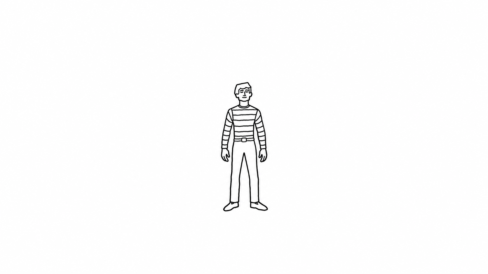

# Freedom from Finality

> "The freedom from finality allows a piece to grow, allows the computer to learn."
> — Myron W. Krueger, *Artificial Reality*

Here it means a story with no ending. It keeps growing, and it keeps what it learns about the person watching.

**Freedom from Finality (FFF)** is an endless film, made while you watch. Two LLMs write it, a video model renders it, and you steer it by simply typing. Nothing is scripted. It never ends, never resets, and picks up where you left off.

<p align="center"></p>

Every story starts from this frame: MacLaren, alone in The White. Everything after it is written live.

## How it works

```
you type (or don't)
  → Now (LLM) writes the next beat: 1-4 clips of action, dialogue and world changes
  → code checks it against the world model and turns each clip into a video prompt
  → LTX-2.5 renders each 6 s clip with sound, starting from the last frames of the one before
  → the browser plays the clips back to back
meanwhile Then (LLM) keeps the story's memory, off the critical path
```

- **The LLMs propose, code decides.** The world (characters, props, places, who has what) is a typed model that only code changes. Everything Now writes goes through a validator first. No tool calls, no agent loop.
- **Two clocks.** Now is on the critical path: one call per beat, about 6 s. Then runs every ten clips or so and never holds up the picture. It summarises, keeps notes on the characters and on you, and marks where the story turned.
- **One continuous shot.** Every clip is conditioned on the last 9 frames of the one before, so the picture never jumps back to a fresh start. All the sound, voices included, comes from the video model.
- **Just in time.** Each render starts a few seconds before its clip is due, and a 6 s clip renders in 3-4 s on an H100. What you type cuts the current beat short and is on screen about two clips later.
- **Suggestions, not commands.** What you type is taken up in the story's own way. Maybe with a twist, a character who refuses, or a consequence that comes later.

## One story, for good

You get one story, and it never ends. **Begin** the first time, **Continue** after that, **Stop** whenever. It's saved as of the last clip you saw, in `story/` on your computer. Copy the folder to back it up.

The video isn't kept. Clips are deleted once they've played. Only the last 9 frames (about 200 KB) are saved, because that's all the next clip needs.

The story remembers in layers: the last six clips word for word, then summaries, then checkpoints where it turned, then the story so far. What the LLMs read stays the same size however long it runs. When someone comes back after two hours, their past comes back with them. It remembers you too: what you typed, what the story did with it, and what Then makes of you, each guess tied to the inputs behind it. Lookup is by name, no embeddings.

## Run it

Easiest: open the repo in your coding agent (Claude Code, Codex, Cursor...) and say *set up FFF for me*. It follows [SETUP.md](SETUP.md): the keys, renting a GPU, and what it costs (about $2.50-8 for a 30-minute film, mostly the GPU).

By hand, with Python 3.11+ and keys for OpenAI, Hugging Face and [Vast.ai](https://vast.ai):

```bash
git clone https://github.com/artificial-realities/freedom-from-finality.git && cd freedom-from-finality
python3 -m venv .venv && source .venv/bin/activate
pip install -r requirements.txt vastai
cp .env.example .env         # add your keys
server/vast_run.sh check     # keys ready? what does renting cost right now?
server/vast_run.sh up        # rent an H100 and start the video server (5-20 min)
server/vast_run.sh run       # open http://127.0.0.1:8765/ and press Begin
server/vast_run.sh down      # bring your story home and stop paying
```

Have an 80 GB NVIDIA GPU of your own (H100 or newer)? Skip Vast: see [SETUP.md](SETUP.md#your-own-gpu).

## Where it stands

- **Video:** measured on H100 and H200 with earlier stories. A 300-clip film rendered with no slowdown, and its only pauses came from slow LLM calls. Typed input reached the screen two clips later.
- **MacLaren's story** (the layered memory, the memory of you) has only played as text so far: three films of 150-300 clips, under $0.30 of OpenAI each. Not yet as video.
- **Open problems:** a slow Now call can still pause the picture for a moment. Continuity fights steering: the more a clip holds on to the last one, the less a new prompt lands. Long films drift visually.

## What leaves your computer

While a film plays, Now and Then call OpenAI with your key, sending the story as they need it and what you typed. The video renders on the GPU server you run. Nothing else goes anywhere, and there's no telemetry. What you type is kept in `story/viewer.jsonl` (the story's memory of you) and in the technical logs of the last 20 films. The page has no login and listens on `127.0.0.1` only, since everything typed into it is billed to your key.

## More

- [docs/ARCHITECTURE.md](docs/ARCHITECTURE.md): how it works, in full.
- [docs/decisions.md](docs/decisions.md): why it's built this way, with the numbers.
- [src/prompts/policy.md](src/prompts/policy.md): what the story will never show.
- [AGENTS.md](AGENTS.md): working on the code. `ruff check .` is the only gate; there's no test suite, on purpose. Issues and pull requests are welcome.

## License

The code is [MIT](LICENSE). An [Artificial Realities](https://github.com/artificial-realities) project by Simen Bihaug-Frøyland ([@sbfroy](https://github.com/sbfroy)).

The LTX-2.5 weights by [Lightricks](https://huggingface.co/Lightricks) aren't part of this repo. They download from Hugging Face under the LTX-2 Community License, which has its own terms.
