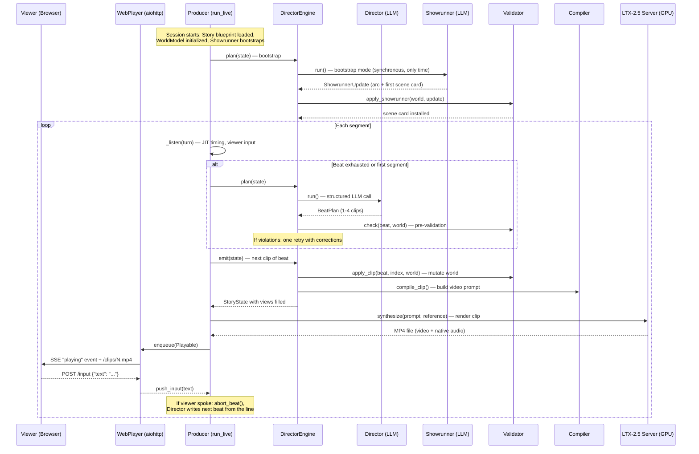
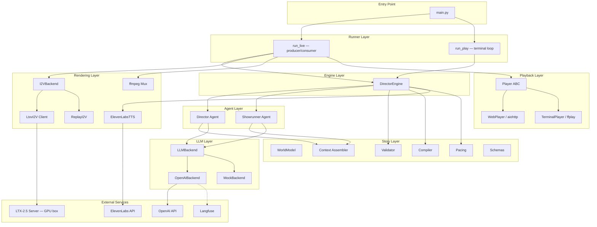
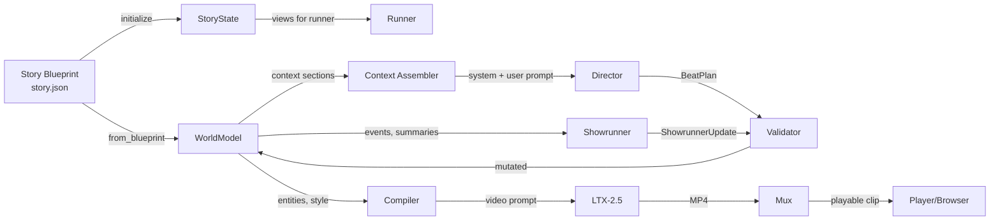
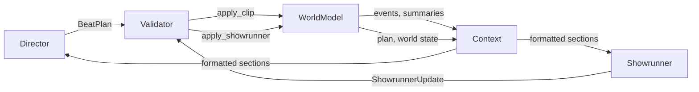
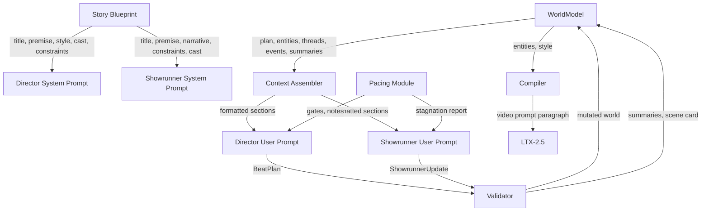
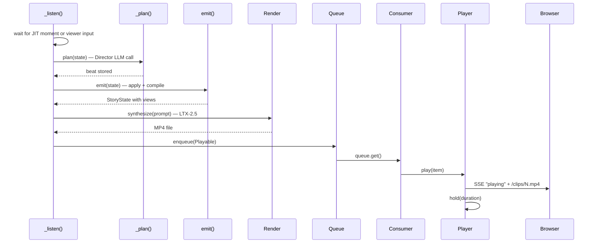
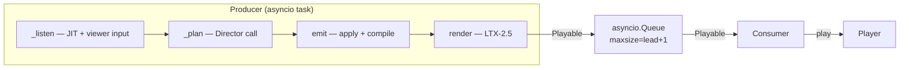

# PROJECT_SYSTEM_AUDIT.md

**Artificial Realities — Comprehensive System Audit**
*Generated 2026-09-18*

---

## Table of Contents

1. [Overall System Understanding](#1-overall-system-understanding)
2. [System Reconstruction](#2-system-reconstruction)
3. [Agents in Depth](#3-agents-in-depth)
4. [Prompt Inventory](#4-prompt-inventory)
5. [Exhaustive Feature Inventory](#5-exhaustive-feature-inventory)
6. [State, Memory and Context](#6-state-memory-and-context)
7. [End-to-End Generation Pipeline](#7-end-to-end-generation-pipeline)
8. [User Intervention Pipeline](#8-user-intervention-pipeline)
9. [Video Generation System](#9-video-generation-system)
10. [Concurrency, Streaming and Latency](#10-concurrency-streaming-and-latency)
11. [Configuration and Model Settings](#11-configuration-and-model-settings)
12. [Frontend ↔ Backend Interaction](#12-frontend--backend-interaction)
13. [Error Handling and Fallbacks](#13-error-handling-and-fallbacks)
14. [Potentially Important Implementation Details](#14-potentially-important-implementation-details)
15. [Suspicious, Unclear or Potentially Problematic Behavior](#15-suspicious-unclear-or-potentially-problematic-behavior)
16. [Improvement Opportunities](#16-improvement-opportunities)
17. [Repository Map](#17-repository-map)
18. [Traceability Index](#18-traceability-index)

---

## 1. Overall System Understanding

### What the System Is

Artificial Realities is an interactive generative movie platform. It produces a continuously streaming AI-generated film whose story responds to viewer input while it plays. The viewer watches a video stream in a browser and types free-text guidance at any moment; the system interprets that guidance as story intent and reflects it in what happens next.

The system is not a clip generator with a text box. It is a system that holds a story together across a long runtime while remaining open to influence — continuous generation, narrative continuity, viewer steering, and cinematic cohesion, all at once.

### How It Works at the Highest Level

Two LLM roles run on two clocks over a typed world model:

- A **Director** (fast clock) writes one beat of the film per call — one action or state as 1-4 clips. The engine emits the clips one per segment with no LLM call in between. When the viewer speaks, the rest of the beat is dropped and the Director is called again immediately with the viewer's line.
- A **Showrunner** (slow clock) runs asynchronously off the critical path. It compacts the event log into summaries and writes the plan (story arc + next scene card). It never blocks the film.

Code owns everything else: the typed `WorldModel`, validation and apply logic, the prompt compiler (which translates beats into video-model prompts), pacing gates, and persistence.

Video is rendered by LTX-2.5 running as a resident inference server on a GPU box. The server owns a sliding window: the tail of each generated chunk conditions the next, carrying visual state forward. Only the first clip of a run is seeded from the reference image.

Playback is a web player: the film streams to a browser clip by clip, holds the last frame while the next renders, and takes typed input at any moment.

### Lifecycle of a Session



### The Strict Division of Responsibility

| Layer | Owns | Does NOT do |
|-------|------|-------------|
| **Director (LLM)** | Proposes beats: action, camera, entity ops, voice-over, viewer disposition | Never mutates world, never decides when to run, never compiles prompts |
| **Showrunner (LLM)** | Compresses history, writes arc and scene cards | Never writes beats, never blocks the pipeline |
| **Validator** (`validator.py`) | Checks proposals, applies admissible ops to world | Never creates content, never calls LLMs |
| **Compiler** (`compiler.py`) | Translates beat clips into LTX-2.5 video prompts | Never reads world constraints, never changes schema |
| **Engine** (`director_engine.py`) | Orchestrates: when to call whom, emit clips, trigger Showrunner, manage beat state | Never writes prose, never renders video |
| **Runner** (`runner.py`) | JIT timing, rendering, muxing, queueing, playback coordination | Never touches story logic |
| **Player** (`player.py`, `server.py`) | Playback clock, viewer I/O, SSE streaming | Never renders, never orchestrates |

---

## 2. System Reconstruction

### Architecture Diagram



### Data Flow: State Through the Pipeline



### The Two Clocks

| Clock | Role | Trigger | Blocking? | Frequency |
|-------|------|---------|-----------|-----------|
| **Fast** | Director | Beat exhausted or viewer speaks | Yes (on the critical path) | Every 1-4 clips |
| **Slow** | Showrunner | Bootstrap, scene_done, needs_replan, stagnation, compaction_interval | Never (async task) | Every ~4-10 segments, at most one in flight |

---

## 3. Agents in Depth

### 3.1 The Director

**Name**: Director

**Responsibility**: Write the next beat of the film — one action or state as 1-4 clips, each with its picture, world changes, camera, dialogue, voice-over, and viewer disposition.

**Why it exists**: The Director is the only creative voice on the critical path. It decides what happens, how it is shot, and exactly what changes in the world, clip by clip.

**What it receives**:
- **System prompt** (`director.system.md`): title, premise, world constraints, visual style, cast (with looks, reference pose, speaks flag), locations, voice-over register, clip duration, max clips per beat
- **User prompt** (`director.user.md`): current segment number, plan (arc + scene card with timing), world now (entities with state), open threads, viewer input (current + deferred + momentum), story so far (summaries), recent clips (last 6 verbatim), where the picture is (previous beat status), pacing and gates (voice-over floor, stagnation pressure, scene length)

**What it does NOT receive**: Raw event log (only summaries and recent clips), Showrunner's internal reasoning, video model parameters, rendering timings, previous video frames.

**Structured output**: `BeatPlan` (OpenAI strict JSON schema)
- `intent`: the beat in a few words
- `framing`: shot size and angle
- `clips[]`: 1-4 `ClipSpec` objects, each with `action`, `end_state`, `camera_motion`, `ambient_sound`, `on_screen[]`, `dialogue[]`, `entity_ops[]`
- `voiceover`: narrator line (or empty)
- `thread_ops[]`: open/pay_off/drop
- `intervention`: none/absorbed/deferred/declined + `intervention_reason`
- `scene_done`, `needs_replan`: boolean flags

**Who consumes the output**:
- `DirectorEngine.plan()` stores the beat
- `DirectorEngine.emit()` emits clips one by one
- `validator.apply_clip()` mutates the world per clip
- `compiler.compile_clip()` builds the video prompt per clip
- `StoryState` views are filled for the runner, player and transcript

**When it runs**: Called by `DirectorEngine.plan()` when the current beat has no more clips, or immediately when the viewer speaks (the beat in progress is aborted first).

**Synchronous/async**: Async. In the live loop, a Director call in flight can be cancelled by viewer input; the call restarts with everything the viewer typed.

**State access**: Reads a snapshot of the `WorldModel` via `context.py` formatters. Does not read or write the world directly.

**Memory**: None. Stateless per call. All continuity comes from the context window (summaries + recent clips + world state).

**How it influences video**: The `action`, `end_state`, `camera_motion`, `ambient_sound`, `on_screen` and `dialogue` fields of each `ClipSpec` are compiled into a single paragraph that becomes the LTX-2.5 prompt. The `voiceover` is folded into the prompt when `narration_mode == "ltx"`.

**Constraints**:
- Clips are capped at `max_clips_per_beat` (default 4)
- Voice-over is gated by `voiceover_gate()` — cleared if the gate is closed
- If `clip_seconds` is set, every clip is told to plan for exactly that duration
- World constraints from the blueprint are presented as physics
- The picture never cuts — angle changes are camera moves
- Entity ops must use exact ids from "World now"

**Fallback on failure**: If the LLM call returns None (parse failure), the engine substitutes a `_fallback_beat()`: "holding the picture" with one clip of the protagonist standing still.

**Retry behavior**: After the first call, `validator.check()` runs. If there are hard violations (unknown entities, locked cast, mute character speaking), the entire user prompt is re-sent with the violations appended as corrections. Exactly one retry. If the retry still has violations, the better of the two proposals is used and the invalid ops are silently dropped at apply time.

**Implementation**: `src/agents/director.py` (`run()` function, `_call()` helper), called from `DirectorEngine.plan()` at `src/graph/director_engine.py:141`.

---

### 3.2 The Showrunner

**Name**: Showrunner

**Responsibility**: Compress the event log into summaries (scene summary, act summary, entity notes) and write the plan (story arc + next scene card).

**Why it exists**: The Director sees only a bounded context window (summaries + recent clips). As a run grows, someone must compact the raw event log into useful summaries and keep the story's arc and scene cards alive. The Showrunner is the slow-clock role that does this without blocking the film.

**What it receives**:
- **System prompt** (`showrunner.system.md`): title, premise, long-term narrative, short-term narrative, world constraints, cast, locations, principles (escalation, callbacks, dormant props)
- **User prompt** (`showrunner.user.md`): trigger reason, segment number, current plan (arc + scene card with timing), story so far (summaries, up to 6 scenes), events since last compaction, world now, open threads (up to 12), all viewer requests (up to 12), stagnation report, and a mode-specific instruction

**Three modes**:
1. **bootstrap**: The film hasn't started. Write the arc and opening scene card. Nothing to summarize.
2. **replan**: A scene boundary or stalled scene. Compact events, then write the next scene card.
3. **compact**: Mid-scene compaction pass. Summarize events. If stagnation is above threshold, set `replan = true` and write a new scene card.

**Structured output**: `ShowrunnerUpdate`
- `scene_summary`: prose summary of events since last compaction
- `act_summary`: updated act summary
- `entity_notes[]`: durable facts about entities
- `threads_to_drop[]`: thread ids to abandon
- `arc[]`: the full list of acts
- `current_act`: zero-based index
- `replan`: whether to write a new scene card
- `next_scene`: `SceneCardOut` (goal, tension, exit_condition, intensity, candidate_beats)
- `rationale`: one or two sentences on why

**Who consumes the output**: `validator.apply_showrunner()` applies the update to the `WorldModel` at `DirectorEngine._land()`.

**When it runs**: Triggered by `DirectorEngine._trigger()` on these conditions:
- `beat.scene_done` (the Director says the scene is over)
- `beat.needs_replan`
- Stagnation: `seconds_since_change() >= 1.5 * stagnation_seconds` AND min gap met
- Compaction interval: `segment - last_compacted >= compaction_interval`
- Bootstrap: `world.plan.scene is None` (synchronous, the only time it blocks)

**Async/non-blocking**: Runs as an `asyncio.Task` on a deep copy of the world. The fast clock never waits for it. Its update lands at the start of the first `plan()` call that finds the task finished (`_land_if_done()`). At most one in flight, at least `showrunner_min_gap` segments apart.

**State access**: Receives a deep copy of `WorldModel` at spawn time. Cannot see changes the Director makes after it was spawned.

**Memory**: None. Each call is independent. Continuity comes from the summaries it has written previously (which are in the world model it receives).

**How it influences video**: Indirectly. Its scene card (goal, tension, exit condition, intensity, candidate beats) is shown to the Director in the "Plan" section of the user prompt. The Director uses it to decide what happens next.

**Constraints**:
- Held if a run is already in flight or `showrunner_min_gap` hasn't passed
- The bootstrap is the only synchronous call
- If the bootstrap fails, the engine installs a fallback `SceneCard`

**Implementation**: `src/agents/showrunner.py` (`run()` function), spawned from `DirectorEngine._spawn_showrunner()` at `src/graph/director_engine.py:358`, landed at `_land()` at line 436.

---

### 3.3 How the Agents Communicate

The Director and Showrunner never communicate directly. They share information through the `WorldModel`:

1. The **Showrunner** writes summaries, entity notes, the arc, and scene cards into the world model (via `apply_showrunner()`).
2. The **Director** reads those structures as formatted prompt sections (via `context.py`).
3. The Director's beat proposals are validated and applied by the same `WorldModel`, producing events that the Showrunner later reads.



**Authority boundaries**:
- The Director has authority over what happens in each beat: action, camera, world changes, viewer handling.
- The Showrunner has authority over the plan: the arc, scene cards, summaries, and which threads to drop.
- The validator has authority over what is admissible: it can reject entity ops, drop dialogue from mute speakers, and force scene_done based on scene length.
- The engine (`DirectorEngine`) has authority over timing: when each role runs, when beats are cut short, when the Showrunner is spawned or held.

**There is no overlap**: the Director never writes summaries or scene cards; the Showrunner never writes beats or handles viewer input.

---

## 4. Prompt Inventory

### 4.1 Director System Prompt

**File**: `src/prompts/director.system.md`
**Used by**: `src/agents/director.py:run()`
**When invoked**: Every Director call (once per beat, or on viewer interrupt)

**Placeholders**:
| Variable | Source | Description |
|----------|--------|-------------|
| `{title}` | `state.title` or `world.title` | Film title |
| `{narrative_premise}` | `state.narrative_premise` | Story premise |
| `{world_constraints}` | `format_rules(state.world_constraints)` | Bulleted list of absolute rules |
| `{visual_style}` | `state.visual_style` | Full visual style paragraph |
| `{cast}` | `format_cast(world)` | Characters with ids, descriptions, looks, reference pose, speaks flag |
| `{locations}` | `format_locations(world)` | Location ids and descriptions |
| `{tone_guidelines}` | `state.tone_guidelines` | Voice-over register |
| `{clip_seconds}` | `config.clip_seconds or config.i2v_duration` | Duration each clip should plan for |
| `{max_clips}` | `config.max_clips_per_beat` | Maximum clips per beat |

**Main instructions**: The Director is told it is the only creative voice on the critical path. Key rules:
- Continuing is the default; most beats develop what is already happening
- Let things last; do not end a state because a beat ends
- Every world change needs an `entity_op` in the clip where it happens
- The picture never cuts — changes of angle are camera moves
- The first clip of the film starts from the reference image pose
- The viewer is a co-author; a request outranks the scene card
- Voice-over is punctuation, not commentary; most beats have none
- Return JSON only

**Important behavioral wording**: "The viewer is a co-author sitting next to you, and a request outranks the scene card: the plan bends to the viewer, not the other way round."

**Cache behavior**: The system prompt never changes during a run (cast, rules, style are from the blueprint), so the API's prompt cache hits every call.

---

### 4.2 Director User Prompt

**File**: `src/prompts/director.user.md`
**Used by**: `src/agents/director.py:run()`

**Template sections** (in order):
1. `Segment {segment}` — current segment number
2. `## Plan` — `format_plan(world, config)`: arc with current act marker, scene card with timing
3. `## World now` — `format_world_now(world)`: location, present entities with state, dormant props, gone props
4. `## Open threads` — `format_threads(world)`: up to 8 most recent open threads
5. `## Viewer` — `format_interventions(world, state.user_input)`: current input + disposition instruction, viewer momentum, deferred requests, recently handled
6. `## Story so far` — `format_summaries(world)`: opening scene pinned, act summary, recent scene summaries
7. `## Recent clips (newest last)` — `format_recent(world, config.recent_clips)`: last 6 clips verbatim with on_screen, end_state, voice-over
8. `## Where the picture is` — `beat_status`: how the previous beat ended (full, cut short, or opening)
9. `## Pacing and gates` — `format_gates()`: voice-over floor status, pacing pressure, scene length note

**Why the user prompt carries mutable state**: The system prompt stays fixed for cache hits. Everything that changes between calls — plan, world state, threads, viewer input, summaries, recent clips, pacing — goes in the user prompt.

**Output schema**: `BeatPlan` via OpenAI strict structured outputs

**On retry**: The user prompt is re-sent with `## Corrections required` appended, listing the violations from `check()`.

---

### 4.3 Showrunner System Prompt

**File**: `src/prompts/showrunner.system.md`
**Used by**: `src/agents/showrunner.py:run()`

**Placeholders**:
| Variable | Source | Description |
|----------|--------|-------------|
| `{title}` | `state.title` | Film title |
| `{narrative_premise}` | `state.narrative_premise` | Story premise |
| `{long_term_narrative}` | `state.long_term_narrative` | Blueprint's long-term direction |
| `{short_term_narrative}` | `state.short_term_narrative` | Blueprint's opening direction |
| `{world_constraints}` | `format_rules(state.world_constraints)` | World rules |
| `{cast}` | `format_cast(world)` | Cast |
| `{locations}` | `format_locations(world)` | Locations |

**Main instructions**: Two jobs — memory (compress, summarize, notes) and planning (arc, scene card). Key principles:
- Escalate; later scenes build on earlier ones
- Callbacks to dormant props are cheap coherence
- Keep the arc short: a few acts, one sentence each
- When stagnation is past threshold and the Director hasn't broken out, break it for them
- A scene's exit condition is something visible that takes minutes to reach
- Honor deferred viewer requests in the next scene

**Output schema**: `ShowrunnerUpdate` via OpenAI strict structured outputs

---

### 4.4 Showrunner User Prompt

**File**: `src/prompts/showrunner.user.md`
**Used by**: `src/agents/showrunner.py:run()`

**Template sections**:
1. `Trigger: {reason}` — why this run was triggered
2. `Segment: {segment}`
3. `## Current plan` — `format_plan(world, config)`
4. `## Story so far` — `format_summaries(world, scene_limit=6)`
5. `## Events since the last compaction` — `format_events(world, world.last_compacted)`: full event log since last compaction
6. `## World now` — `format_world_now(world)`
7. `## Open threads` — `format_threads(world, limit=12)`
8. `## Viewer requests` — `format_interventions_all(world)`: all viewer inputs with dispositions (up to 12)
9. `## Stagnation report` — `stagnation_report(world, config)`: seconds since change, scene length, dormant props
10. `{instruction}` — mode-specific instruction (bootstrap / replan / compact)

---

### 4.5 Video Generation Prompt (Compiler)

**File**: `src/story/compiler.py` (`compile_clip()`)
**Used by**: `DirectorEngine.emit()` at `src/graph/director_engine.py:258`
**When invoked**: Once per clip, at emit time

**Not an LLM prompt** — this is the text prompt sent to LTX-2.5 to render a video clip.

**Structure** (one flowing paragraph):
1. **Ambient sound** (if present): e.g., "Soft thud on a flat surface."
2. **Framing + camera**: e.g., "Medium shot, slow push-in camera."
3. **On-screen entities**: listed with descriptions. Opening clip or clip that introduces an entity: full look. Continuing clips: `look_short` or just the name. Capped at `DESCRIBED_IN_FULL = 6` entities.
4. **Reference pose** (opening clip only): "The shot opens with Lego Man standing upright..."
5. **Action**: the clip's action text.
6. **Dialogue**: `Name says (delivery): "line"`
7. **End state**: "Final frame: ..."
8. **Voice-over** (first clip of beat, `narration_mode == "ltx"` only): `A narrator's voice-over (English, warm, unhurried documentary narrator) says: "..."`
9. **Visual style prefix**: Opening clip: full `visual_style`. Continuing clips: `visual_anchor` (or first sentence of `visual_style`).

**Design decision**: The compiler is the only place that knows the video model's dialect. When the video model changes, this file changes; the schemas do not.

---

### 4.6 Prompt Dependencies



---

## 5. Exhaustive Feature Inventory

### 5.1 Beat-Based Generation

**What it does**: The Director writes one beat per call — one action or state of the film as 1-4 clips. The engine emits clips one per segment with no LLM call in between.

**How it works**: `DirectorEngine.plan()` calls the Director agent. The returned `BeatPlan` is stored as `self._beat`. `emit()` advances `self._clip_index` through the clips. When all clips are emitted, the next `plan()` is triggered.

**Why it exists**: A beat groups related clips under one intent, reducing LLM calls (previously one per clip). A beat can be cut short by the viewer after any clip, and the world stays true to what was rendered because each clip's ops are applied individually.

**Where**: `src/graph/director_engine.py` (plan/emit/has_next_clip), `src/story/schemas.py` (BeatPlan, ClipSpec)

**Interactions**: Validator applies each clip's ops individually. Compiler builds one prompt per clip. The runner renders each clip independently.

---

### 5.2 Beat Aborting on Viewer Input

**What it does**: When the viewer speaks, any unrendered clips of the current beat are dropped. The Director is called again immediately with the viewer's line.

**How it works**: `DirectorEngine.abort_beat(reason)` sets `self._beat = None`, records `self._pending_note` describing what was cut (for the next Director call's "Where the picture is" section), and returns the number of dropped clips.

**Why it exists**: The viewer's line should affect the film as soon as possible. Dropping unrendered clips and replanning from the current picture state gives the fastest response.

**Where**: `src/graph/director_engine.py:182-212`, called from `src/eval/runner.py:539,551`

---

### 5.3 Viewer Momentum

**What it does**: When the Director absorbs a viewer's line, that line is stored as `viewer_momentum` in the world model. Subsequent Director calls (even without new viewer input) see this momentum and are told to "develop it naturally, build on its consequences."

**How it works**: Set at `DirectorEngine.emit()` line 253 when `beat.intervention == "absorbed"`. Cleared when the Showrunner opens a new scene (`apply_showrunner()` at `validator.py:328`).

**Why it exists**: Without momentum, a viewer's input would affect one beat and then the Director would snap back to the scene card. Momentum makes steering persistent.

**Where**: `src/story/world.py:153-154` (fields), `src/graph/director_engine.py:253` (set), `src/story/context.py:158-163` (formatted for Director), `src/story/validator.py:328` (cleared on new scene)

---

### 5.4 Viewer Intervention Tracking

**What it does**: Every viewer line is recorded as an `Intervention` object with a segment number, text, disposition (pending → absorbed/deferred/declined), reason, and resolution segment.

**How it works**: `world.add_intervention()` records the line as pending. The Director's `intervention` field determines the disposition. `apply_clip()` resolves pending interventions on the first clip of a beat. Deferred interventions are shown to the Director in subsequent calls.

**Why it exists**: The system needs to track what the viewer asked for, whether it was handled, and what is still owed — across multiple beats and scene transitions.

**Where**: `src/story/world.py:86-88` (Intervention model), `src/story/world.py:237-249` (add/drop), `src/story/validator.py:252-269` (apply dispositions), `src/story/context.py:143-173` (format for Director)

---

### 5.5 Typed World Model

**What it does**: The complete state of the story world — entities (characters, props, locations), threads, interventions, plan, events, summaries — in a typed Pydantic model.

**How it works**: `WorldModel` is a `BaseModel` with `Entity`, `Thread`, `Intervention`, `Plan` (arc + `SceneCard`), `Summary`, and `EventRecord` as nested models. Only `validator.py` mutates it.

**Why it exists**: Prose is never the source of truth. The world model is the system of record that both agents read (via context formatters) and the validator writes.

**Where**: `src/story/world.py`

---

### 5.6 Entity State (Posture, Activity, Position)

**What it does**: Each character entity carries `posture` (how the body is arranged), `activity` (what they are doing, sustained), and `position` (where in the frame). Each prop carries `status`, `holder`, and `location`.

**How it works**: The Director writes `entity_ops` with these fields. `apply_clip()` updates the entity. The Director's next call sees these as the character's `now` line in "World now".

**Why it exists**: Without persistent character state, the Director had to rediscover what the character was doing from the recent clips. With explicit state, the next beat starts from a known physical configuration.

**Where**: `src/story/world.py:50-52` (Entity fields), `src/story/validator.py:166-175` (apply), `src/story/context.py:93-101` (format)

---

### 5.7 Cast Lock

**What it does**: When `cast_locked: true` in the blueprint, no new characters can be introduced. Props and locations are unaffected.

**How it works**: `check()` in the validator rejects `introduce` ops with `kind == "character"` when `world.cast_locked`. `apply_clip()` also skips them.

**Why it exists**: The Lego Man story has one character only. Cast lock is a world constraint that the schema enforces.

**Where**: `src/story/world.py:139`, `src/story/validator.py:57-62,131-132`, `src/models/story.py:43`

---

### 5.8 Mute Character Enforcement

**What it does**: Characters with `speaks: false` cannot have dialogue lines. The validator rejects dialogue from mute characters during `check()` and silently drops it during `apply_clip()`.

**How it works**: `check()` at `validator.py:100-103` adds a violation. `apply_clip()` at line 226-229 filters dialogue to speakers that exist and can speak.

**Why it exists**: The Lego Man never speaks. This constraint ensures the Director cannot accidentally write dialogue.

**Where**: `src/story/world.py:46` (Entity.speaks), `src/story/validator.py:100-103,226-229`

---

### 5.9 Thread Management

**What it does**: Narrative threads (setups, promises, gags, tensions) can be opened, paid off, or dropped. Open threads are shown to the Director; the Showrunner can also drop threads.

**How it works**: `ThreadOp` in the Director's output. `apply_clip()` creates `Thread` objects on `open`, changes status on `pay_off`/`drop`. The Showrunner can drop threads via `threads_to_drop`.

**Why it exists**: Threads create coherence across the film. A setup introduced in segment 3 can be paid off in segment 20, and the system tracks it.

**Where**: `src/story/world.py:74-79` (Thread model), `src/story/schemas.py:47-53` (ThreadOp), `src/story/validator.py:233-249` (apply), `src/story/context.py:132-140` (format)

---

### 5.10 Scene Card System

**What it does**: The Showrunner writes scene cards with a goal, tension, exit condition, intensity target, and candidate beats. The Director sees the card and works toward the exit condition.

**How it works**: `SceneCard` in the world model. The Showrunner's `next_scene` output becomes a new card when `replan == true` or `force_replan`. The Director's `scene_done` flag signals the exit condition is met, triggering a Showrunner run.

**Why it exists**: Scenes give the film structure. A scene lasts a few minutes; without scene cards the story would have no pacing or direction.

**Where**: `src/story/world.py:92-98` (SceneCard), `src/story/validator.py:313-329` (apply), `src/story/context.py:42-66` (format for Director)

---

### 5.11 Story Arc

**What it does**: A list of act summaries (one sentence each) with a current act pointer. The Showrunner writes and updates it.

**How it works**: `world.plan.arc` is a list of strings. `world.plan.current_act` is a zero-based index. Updated by `apply_showrunner()`.

**Why it exists**: The arc gives the film a long-term direction that the Director can see and the Showrunner can update.

**Where**: `src/story/world.py:101-104` (Plan model), `src/story/validator.py:308-311` (apply), `src/story/context.py:44-48` (format)

---

### 5.12 Voice-Over Gate

**What it does**: Controls when the Director may produce a `voiceover` line. The gate opens only when enough silence has accumulated (`min_pause_seconds`), narration is not "off", and no audio is owed.

**How it works**: `voiceover_gate()` in `pacing.py` returns True/False. The engine checks it before `plan()` and clears the voiceover if the gate is closed.

**Why it exists**: Without gating, the Director would produce voice-over on every beat, making the narration relentless. The gate enforces cinematic silence between lines.

**Where**: `src/story/pacing.py:17-25`, `src/graph/director_engine.py:137,152`

---

### 5.13 Pacing Pressure (Stagnation Ladder)

**What it does**: Generates escalating pressure text when nothing in the world has changed for a while, counted in story seconds.

**How it works**: `pacing_note()` checks `world.seconds_since_change()` against `stagnation_seconds`. Three levels:
1. Below threshold: "The story is moving; no pacing pressure."
2. 1× to 1.5×: "Land a concrete development in this beat or the next."
3. Above 1.5×: "A structural shift is REQUIRED NOW."

**Why it exists**: Without pressure, the Director can hold the same state indefinitely. The ladder escalates from suggestion to demand.

**Where**: `src/story/pacing.py:43-60`, shown in the Director's "Pacing and gates" section

---

### 5.14 Scene Length Tracking

**What it does**: Tracks how long the current scene has been running in story seconds, and tells the Director when to close it.

**How it works**: `scene_note()` compares `world.scene_seconds()` against `config.scene_seconds`. At 75%, it says to steer toward the exit condition. At 100%, it demands the scene be closed. The engine also force-sets `beat.scene_done = True` if the scene has exceeded its length (`director_engine.py:155`).

**Why it exists**: Scenes should not run indefinitely. The note gives the Director awareness; the forced flag is a hard cap.

**Where**: `src/story/pacing.py:63-76`, `src/graph/director_engine.py:155`

---

### 5.15 Compaction (Event Log Compression)

**What it does**: The Showrunner compresses raw events into scene summaries, act summaries, and entity notes, so the Director's context window stays bounded.

**How it works**: Triggered every `compaction_interval` segments (default 10). The Showrunner receives all events since the last compaction and writes a `scene_summary`. `apply_showrunner()` stores it as a `Summary` with `scope="scene"` and updates `world.last_compacted`.

**Why it exists**: Without compaction, the event log would grow unbounded and eventually overflow the Director's context window.

**Where**: `src/story/validator.py:282-289` (apply), `src/story/world.py:107-112` (Summary model), `src/graph/director_engine.py:355` (trigger)

---

### 5.16 Dormant Props and Callbacks

**What it does**: Props that were introduced earlier but are no longer `present` are listed as "dormant" in the Director's context. The Director is told that "bringing one back is a callback and usually a good idea."

**How it works**: `world.dormant_props()` returns props where `present == False` and `gone == False`. They are formatted in the "World now" section with their last-seen segment.

**Why it exists**: Callbacks create coherence. A soccer ball introduced in segment 5 can be brought back in segment 40, making the film feel like one film.

**Where**: `src/story/world.py:219`, `src/story/context.py:118-122`, Showrunner stagnation report also lists them (`pacing.py:86`)

---

### 5.17 Clip Compilation

**What it does**: Translates one clip of a beat into a single-paragraph video prompt for LTX-2.5.

**How it works**: `compile_clip()` assembles: ambient sound, framing + camera motion, on-screen entities (full descriptions on opening/introduction, short on continuation, capped at 6), reference pose (opening only), action, dialogue, end state, voice-over (if applicable), and a visual style prefix (full on opening, anchor on continuation).

**Why it exists**: The video model needs a specific prompt format. The compiler is the only place that knows this format, so changing the video model means changing only this file.

**Where**: `src/story/compiler.py:66-127`

---

### 5.18 Fixed Clip Length

**What it does**: When `clip_seconds` is set (default in live config: 6), every clip is exactly that many seconds regardless of what the Director plans.

**How it works**: The engine reads `self.clip_seconds` (from `config.clip_seconds or config.i2v_duration`). The Director is told to plan for this duration. The compiler always returns this duration. The LTX-2.5 client converts seconds to frames via `snap_to_frame_grid()`.

**Why it exists**: A fixed clip length means one shape to compile on the GPU (fp8 compilation is per-shape, 90-170 s each), constant pacing, and a known steering latency.

**Where**: `src/graph/director_engine.py:93-94`, `src/i2v/ltxv.py:143-145`

---

### 5.19 VAE Frame Grid Snapping

**What it does**: Snaps a raw frame count to the VAE's causal (N×8 + 1) grid.

**How it works**: `snap_to_frame_grid(raw) → ((max(raw, 1) - 2) // 8 + 1) * 8 + 1`. For example, 144 raw frames → 145.

**Why it exists**: The LTX-2.5 VAE requires frame counts on this specific grid.

**Where**: `src/i2v/ltxv.py:233-235`

---

### 5.20 Reference Image Letterboxing

**What it does**: Fits the reference image into the render frame without cropping, using the image's own border color as the fill.

**How it works**: `letterbox_reference()` opens the image, detects the border color (median of outer 4 pixels), scales the subject to 80% of the frame height, and centers it on a canvas of the render size.

**Why it exists**: Without letterboxing, a square reference sent to a wide render would crop the top of the figure. "auto" fill continues the image's own background so no visible rectangle is introduced.

**Where**: `src/i2v/ltxv.py:255-280`

---

### 5.21 Server Restart Detection and Re-seeding

**What it does**: If the LTX-2.5 server loses its session (restart), the client detects it and re-sends the reference image.

**How it works**: A 400 response containing "reference_image" triggers a re-send. The client remembers the original seed image path (`self._seed_image_path`) and re-encodes it.

**Why it exists**: The server keeps the sliding window in GPU memory. A restart loses it. Re-seeding restores the chain.

**Where**: `src/i2v/ltxv.py:197-200`

---

### 5.22 Sliding Window Continuity

**What it does**: The LTX-2.5 server keeps the tail of each generated chunk in memory and conditions the next chunk on it.

**How it works**: Server-side. The client sends `continuity_strength` and `continuity_frames` with each request. At strength 1.0, the new clip is fully conditioned on the previous tail.

**Why it exists**: This is what carries visual state forward from clip to clip — pose, props, environment — without re-seeding from the reference every time.

**Where**: `src/i2v/ltxv.py:177-179` (client parameters), `server/ltx2_server.py` (server implementation)

---

### 5.23 Identity Anchor

**What it does**: Optionally conditions every clip on the reference image as a guiding keyframe.

**How it works**: `ltxv_anchor_strength > 0` sends `anchor_strength` and `anchor_index` in the request. The server uses the reference image as an additional conditioning frame.

**Why it exists**: Originally intended to prevent identity drift. The 2026-09-15 sweep showed it is not needed on the distilled recipe, and an end anchor suppresses the closing action. **Currently off** (`ltxv_anchor_strength: 0.0`).

**Where**: `src/i2v/ltxv.py:187-189`, `src/models/config.py:67-70`

---

### 5.24 Audio Muxing (Ambient Ducking)

**What it does**: When a TTS voice-over is produced, it is mixed over the clip's native ambient audio. The ambient track is ducked to 25% volume under the voice-over.

**How it works**: `mux_audio_into_video()` uses ffprobe to detect native audio, then ffmpeg's `amix` filter with `volume=0.25` on the ambient bed.

**Why it exists**: LTX-2.5 renders native ambient/SFX audio. Replacing it would silently discard what the model generated. Ducking keeps the bed audible without fighting speech.

**Where**: `src/playback/mux.py:58-143`

---

### 5.25 Audio Spanning (Multi-Clip Voice-Over)

**What it does**: When a voice-over line is longer than one clip, the system concatenates multiple silent clips and muxes the audio across the combined unit.

**How it works**: The live loop tracks `pending_span`: a dict with the initial `Playable`, accumulated silent clip paths, the audio file, and the remaining owed seconds. Each subsequent clip is added to the span and `owed` is decremented. When owed reaches zero, `concat_videos_and_mux_audio()` produces the combined file and enqueues it.

**Why it exists**: A voice-over line might be 12 seconds but each clip is only 6 seconds. Without spanning, the audio would be cut off or the clip would be padded with silence.

**Where**: `src/eval/runner.py:656-721`, `src/playback/mux.py:146-248`

---

### 5.26 Just-In-Time Rendering

**What it does**: In the live loop, each clip's render is fired as late as safely possible before it is due on air.

**How it works**: `_needed_at()` calculates when the next clip must be on air based on the consumer's clock. The render is fired at `needed_at - est["render"] * JIT_SAFETY - JIT_MARGIN_S - render_slack_seconds`. Between renders, the producer listens for viewer input.

**Why it exists**: Rendering earlier than necessary means a viewer's line misses more clips. Rendering as late as possible minimizes the steering latency.

**Where**: `src/eval/runner.py:480-488` (`_needed_at()`), `524-529` (fire timing), constants `JIT_SAFETY=1.25`, `JIT_MARGIN_S=0.5`

---

### 5.27 Pipelined Rendering

**What it does**: When the video backend manages continuity server-side (LTX-2.5), and there is no audio spanning in progress, the render is fired in the background while the Director can run in parallel.

**How it works**: `_bg_render_and_enqueue()` is launched as an `asyncio.Task`. The next Director call can overlap with the render because the server's sliding window is sequential but independent of the Director.

**Why it exists**: Without pipelining, the Director would have to wait for the render to complete before planning the next beat. Pipelining hides the Director's call time behind the render.

**Where**: `src/eval/runner.py:434-455` (`_bg_render_and_enqueue()`), `596-608` (pipelined path)

---

### 5.28 Cancellable Director Call

**What it does**: In the live loop, if the viewer types while the Director call is in flight, the call is cancelled and restarted with the full viewer input.

**How it works**: `_plan()` in the runner creates two tasks: the Director call and `player.wait_input(None)`. If `wait_input` completes first, the Director call is cancelled, `graph.discard_pending_input()` forgets the pending intervention, and the call restarts.

**Why it exists**: Without cancellation, a viewer's line typed during a Director call would have to wait until the next beat. This makes steering more responsive.

**Where**: `src/eval/runner.py:490-514`

---

### 5.29 Lead Clip Buffering

**What it does**: The producer renders `lead_clips` clips ahead of the consumer. The consumer waits for `lead_clips + 1` clips before starting playback.

**How it works**: The asyncio queue has `maxsize = lead_clips + 1`. The `lead_ready` event is set when the queue is full. The consumer waits for this event before starting. With `lead_clips: 0`, playback starts as soon as the first clip is ready.

**Why it exists**: A buffer absorbs occasional slow renders or Director retries. With `lead_clips: 1` (live config), the viewer never sees a stall unless the GPU falls behind consistently.

**Where**: `src/eval/runner.py:379,391,758-772`, `src/models/config.py:34-37`

---

### 5.30 Text-Only Film Mode

**What it does**: Without a video backend, the same web player page plays the film as text at story pace.

**How it works**: When `i2v is None`, the `Playable` item has `path = None`. The player receives it and shows the narration text instead of a video. The producer holds each item for its planned duration.

**Why it exists**: Headless development without a GPU. The web player works identically — clips appear as text cards with the same timing, intervention handling, and session flow.

**Where**: `src/eval/runner.py:577-583`, `src/web/player.html` (text mode fallback in the frontend)

---

### 5.31 Structured Output Enforcement

**What it does**: The Director and Showrunner return structured JSON constrained by their Pydantic schemas via OpenAI's strict structured outputs.

**How it works**: `call_llm_structured()` in `_common.py` builds a `response_format` with the schema's JSON schema (strict mode via `to_strict_json_schema()`). The API guarantees the response conforms to the schema.

**Why it exists**: Free-form text parsing is fragile. Strict structured outputs make malformed responses impossible at the API level.

**Where**: `src/agents/_common.py:16-57`, `src/llm/openai_backend.py:79-139`

---

### 5.32 JSON Sanitization and Repair

**What it does**: A multi-stage pipeline to clean and parse LLM responses: sanitize → direct parse → extract JSON from surrounding text → repair truncated objects → fail.

**How it works**: `parse_structured_response()` tries four strategies in order. Sanitization removes null bytes, invisible characters, malformed Unicode escapes. Extraction finds the first `{...}`. Repair walks depth and closes truncated objects.

**Why it exists**: Despite strict structured outputs, edge cases (network truncation, encoding glitches) can produce malformed JSON. The pipeline is a defense in depth.

**Where**: `src/util/json_sanitizer.py`

---

### 5.33 Langfuse Observability

**What it does**: Captures every LLM call (prompts, completions, tokens, latency, cost) and runtime events (render, playback, spans) as traces in Langfuse.

**How it works**: The OpenAI client is imported from `langfuse.openai`, a drop-in wrapper that auto-captures. Runtime events are logged via `langfuse_event()`. Each segment gets a `turn_span()`.

**Why it exists**: Observability for debugging and cost tracking across long sessions.

**Where**: `src/util/langfuse_setup.py`, `src/llm/openai_backend.py:1-6`, `src/eval/runner.py` (turn spans, events)

---

### 5.34 Story Logging (Markdown Transcript)

**What it does**: Writes a Markdown transcript of the session to `logs/`.

**How it works**: `StoryLogger` records each turn: segment number, user input, beat narration, shot details, commentary, world state, context brief, and engine notes.

**Why it exists**: A human-readable log of every session for review and debugging.

**Where**: `src/util/story_log.py`, called from `runner.py:206-216`

---

### 5.35 World Model Persistence

**What it does**: The world model is saved after every clip to `logs/sessions/<session>/`: `world.json` (the model minus events) and `events.jsonl` (append-only event log).

**How it works**: `WorldModel.save()` writes `world.json` and appends new events to `events.jsonl`. `WorldModel.load()` reads both files.

**Why it exists**: A run can be inspected after the fact, and potentially resumed from a saved state.

**Where**: `src/story/world.py:279-301`, called from `DirectorEngine._save()` at `director_engine.py:334`

---

### 5.36 Session Concatenation

**What it does**: After a live run, all played clips are concatenated into a single `full_session.mp4`.

**How it works**: `_save_full_session()` writes an ffmpeg concat demuxer filelist and runs `ffmpeg -c copy`.

**Why it exists**: One output file for the complete session.

**Where**: `src/eval/runner.py:224-250`, called at `runner.py:826-831`

---

### 5.37 Replay Backend

**What it does**: Serves pre-rendered clips from a directory in order, cycling, with an optional delay. Ignores the prompt.

**How it works**: `ReplayI2V` reads `.mp4` files from a directory, serves them in alphabetical order, cycles when exhausted. `manages_continuity = True` so the runner doesn't try to extract frames.

**Why it exists**: Developing the player and the live loop without a GPU. Point it at clips from a previous run and the whole pipeline works.

**Where**: `src/i2v/replay.py`, config `i2v_backend: "replay"` with `i2v_replay_dir` and `i2v_replay_delay`

---

### 5.38 ElevenLabs TTS

**What it does**: Renders the Director's `voiceover` line as speech via ElevenLabs and produces an MP3 file.

**How it works**: `ElevenLabsTTS.synthesize()` calls the ElevenLabs API (`eleven_multilingual_v2` model) in a thread, writes the result to `logs/audio/`.

**Why it exists**: An alternative to LTX-2.5's native audio. A fixed narrator voice with consistent quality.

**Where**: `src/tts/elevenlabs.py`, invoked from `DirectorEngine.emit()` at `director_engine.py:269-281`

---

### 5.39 Scripted Viewer (steer.py)

**What it does**: Posts pre-defined viewer lines to a running web player at specified segments.

**How it works**: Reads a JSON file of `{segment: "line"}` pairs, connects to the SSE stream, and posts each line at the right segment via `POST /input`.

**Why it exists**: Automated testing of viewer steering without manual typing.

**Where**: `scripts/steer.py`

---

### 5.40 Latency Probe (latency_probe.py)

**What it does**: Measures the real-time ratio (seconds of render per second of clip) for a given server setting.

**How it works**: Sends a fixed prompt to the LTX-2.5 server multiple times at different clip lengths and measures the response time.

**Why it exists**: Determining whether the system can run faster than real time, and comparing GPU configurations.

**Where**: `scripts/latency_probe.py`

---

### 5.41 GPU Box Lifecycle (vast_run.sh)

**What it does**: Rents a GPU on Vast.ai, installs dependencies, starts the LTX-2.5 server, opens an SSH tunnel, runs the film on the box, fetches logs, and tears everything down.

**How it works**: Five commands: `up` (rent + install + tunnel), `run` (ship working tree + run main.py on the box), `pull` (rsync logs), `restart` (new server process with different settings), `down` (destroy).

**Why it exists**: The film runs on the GPU box so clips never cross the internet (1.5-4.6 s per clip over SSH tunnel). This is the MVP deployment loop.

**Where**: `server/vast_run.sh`, `server/remote_setup.sh`

---

### 5.42 Location Resolution

**What it does**: Resolves location references leniently: ids, names, and prefixed forms ("at the_white_void", "in The White Void").

**How it works**: `resolve_location()` in the validator strips common prefixes ("at ", "in ", "on ", "inside ", "the "), tries each candidate against `world.resolve()`, and falls back to checking if any location id is a substring of the slugified reference.

**Why it exists**: The Director might write "at the white void" instead of the id "the_white_void". Lenient resolution prevents false rejections.

**Where**: `src/story/validator.py:33-49`

---

### 5.43 Entity Name Cleanup

**What it does**: When the Director introduces an entity with an id-like name (underscores, no spaces), the validator converts it to a human name.

**How it works**: `apply_clip()` at line 134: `if "_" in name and " " not in name: name = name.replace("_", " ")`

**Why it exists**: The Director sometimes sends "soccer_ball" as the name instead of "soccer ball".

**Where**: `src/story/validator.py:134-135`

---

### 5.44 Showrunner Min Gap Enforcement

**What it does**: At least `showrunner_min_gap` segments must pass between two Showrunner runs (any trigger; the bootstrap is exempt).

**How it works**: `_hold_reason()` checks `seg - self._last_spawn < config.showrunner_min_gap`. If too soon, the trigger is noted but not spawned. It is re-evaluated next segment.

**Why it exists**: Without a gap, rapid triggers (e.g., scene_done then compaction) could spawn back-to-back Showrunner runs. The gap prevents churn.

**Where**: `src/graph/director_engine.py:383-397`

---

### 5.45 Forced Scene Closure

**What it does**: If the Director does not set `scene_done` but `world.scene_seconds() >= config.scene_seconds`, the engine force-sets `scene_done = True`.

**How it works**: `DirectorEngine.plan()` at line 155.

**Why it exists**: A hard cap on scene length in case the Director ignores the pacing pressure.

**Where**: `src/graph/director_engine.py:154-156`

---

### 5.46 Showrunner Bootstrap Fallback

**What it does**: If the bootstrap Showrunner call fails (returns None), the engine installs a fallback `SceneCard` so the Director is never without a scene.

**How it works**: `_land()` at line 441-448 creates a minimal scene card: "Open the film on the protagonist..."

**Why it exists**: Without a scene card, the Director's prompt would have "Scene card: (none)" and the film would have no direction at all.

**Where**: `src/graph/director_engine.py:441-448`

---

### 5.47 Service Tier for Director

**What it does**: The `director_service_tier` config option sets the OpenAI processing tier for Director calls ("priority" for faster token throughput).

**How it works**: Passed to `OpenAIBackend` and forwarded as `service_tier` in the API call.

**Why it exists**: The Director call is the per-clip critical path. Priority tier ran gpt-4.1 at ~150 tokens/s instead of ~60 (2.1 s instead of 5.8 s per segment).

**Where**: `src/models/config.py:90-93`, `src/llm/openai_backend.py:33,55`, `src/graph/director_engine.py:69-72`

---

### 5.48 Per-Story Folders

**What it does**: Each story is a directory with `story.json`, a reference image, and any other assets. The default is `stories/lego-void`.

**How it works**: `Story.from_json()` accepts a directory, looks for `story.json` inside it, and resolves relative paths for `seed_image` and character `reference_image` against the story directory.

**Why it exists**: Stories are self-contained. The engine, prompts, schemas, and compiler are story-agnostic.

**Where**: `src/models/story.py:46-60`, `stories/lego-void/`

---

### 5.49 Presence Tracking

**What it does**: Entities listed in `on_screen` have their `present` flag set to True and their references normalized to ids.

**How it works**: `apply_clip()` at lines 214-224 iterates `clip.on_screen`, resolves each reference, sets `present = True` and `last_seen = seg`, and replaces the reference with the entity id.

**Why it exists**: "World now" shows what is present in the scene. Presence is tracked per-clip so the Director always has an accurate picture.

**Where**: `src/story/validator.py:214-224`

---

### 5.50 Entity Description Cap

**What it does**: In the compiled video prompt, at most `DESCRIBED_IN_FULL = 6` entities get their full description. The rest are named only.

**How it works**: `compile_clip()` sorts entities (characters first, then props by kind) and calls `describe(e, full=...)` for the first 6, just `e.name` for the rest.

**Why it exists**: The video prompt has limited space. More than 6 detailed entity descriptions would overwhelm the prompt.

**Where**: `src/story/compiler.py:63,94-95`

---

### 5.51 Opening vs. Continuing Clip Distinction

**What it does**: The first clip of a run (segment 1) gets the full visual style, full entity looks, and the reference pose. All subsequent clips get the short visual anchor and short looks.

**How it works**: `compile_clip()` checks `opening` (True for segment 1). `describe(e, full=opening or e.first_seen == segment_no)` gives full looks on introduction. The style prefix is `visual_style` for opening, `visual_anchor` for continuation.

**Why it exists**: Repeating the full style and looks on every clip wastes prompt tokens and confuses the model. The opening clip establishes the look; subsequent clips just remind.

**Where**: `src/story/compiler.py:76,94,123-127`

---

### 5.52 Running Time Estimates

**What it does**: The live loop maintains running averages of render and Director call times, used for JIT scheduling.

**How it works**: `_learn(key, seconds)` updates the estimate with `0.5 * prev + 0.5 * new`. Used by `_listen()` to calculate when to fire the next render.

**Why it exists**: JIT scheduling needs to predict how long the next render and Director call will take.

**Where**: `src/eval/runner.py:421-425`

---

### 5.53 Server Health Probing

**What it does**: The LTX-2.5 client probes the server's `/health` endpoint on first use to get the frame rate and render size.

**How it works**: `_probe_health()` makes a GET request with a 10-second timeout. The result is cached (but only a success; a failure is re-probed next call).

**Why it exists**: Client and server must agree on frame rate and render size. Probing prevents silent disagreement.

**Where**: `src/i2v/ltxv.py:101-133`

---

### 5.54 Negative Prompt

**What it does**: A fixed negative prompt sent with every LTX-2.5 request to suppress visual artifacts.

**How it works**: `ltxv_negative_prompt` in the config is passed through to the server.

**Why it exists**: The 2026-09-08 sweep identified a green-face artifact that the negative prompt removes.

**Where**: `src/models/config.py:62-63`, `src/i2v/ltxv.py:83`

---

### 5.55 Summary Pinning (Opening Scene)

**What it does**: The opening scene summary is always shown to the Director, regardless of how many scenes have passed.

**How it works**: `format_summaries()` puts `scenes[0]` first, prefixed with "Opening (segments...)". Then the act summary. Then the most recent `scene_limit` summaries.

**Why it exists**: The start of a film is what viewers refer back to. The Director should always know how the film opened.

**Where**: `src/story/context.py:186-200`

---

### 5.56 Context Budget Limits

**What it does**: Multiple caps bound the size of each context section:
- `PRESENT_IN_FULL = 12`: entities shown with full details
- `STATUS_CHARS = 120`: status text clipped
- `GONE_LISTED = 12`: recently gone entities
- `NOTES_SHOWN = 4`: entity notes per entity
- Threads limited to 8 (Director) or 12 (Showrunner)
- Recent clips: `config.recent_clips` (default 6)
- Summaries: `scene_limit` (3 for Director, 6 for Showrunner)

**Where**: `src/story/context.py:69-72` (constants), various formatter functions

---

### 5.57 Deferred Intervention Resolution

**What it does**: When the Director absorbs or declines a response and there are no pending interventions (because the Director is handling an older line), the most recent deferred intervention is resolved.

**How it works**: `apply_clip()` at lines 263-269: if `beat.intervention` is absorbed/declined and no pending items exist, the last deferred item gets the disposition.

**Why it exists**: A deferred request from segment 5 might be fulfilled in segment 10 when the Director writes "absorbed" without a new viewer line.

**Where**: `src/story/validator.py:263-269`

---

### 5.58 No-Disposition Warning

**What it does**: If the viewer typed something but the Director returned `intervention: "none"`, the validator automatically changes it to "deferred" and adds a warning.

**How it works**: `apply_clip()` at lines 256-258.

**Why it exists**: The Director should always acknowledge viewer input. If it forgot, "deferred" is safer than "none" because it keeps the request alive.

**Where**: `src/story/validator.py:255-258`

---

---

## 6. State, Memory and Context

### 6.1 State Types

| State | Where it lives | Updated by | Read by | Survives |
|-------|---------------|------------|---------|----------|
| **WorldModel** | `DirectorEngine.world` | `validator.apply_clip()`, `validator.apply_showrunner()` | Context assembler → Director & Showrunner prompts, Compiler | Persisted per clip to `logs/sessions/<session>/` |
| **StoryState** | `run_live` / `run_play` local variable | Engine `.emit()` fills views; runner manages pacing fields | Runner, Player, Transcript, History | Not persisted (lives in memory for the session) |
| **Blueprint** (Story) | `StoryState` blueprint fields, loaded once | Never modified | System prompts (Director, Showrunner), Compiler | Immutable for the session |
| **Beat state** | `DirectorEngine._beat`, `_clip_index`, `_beat_no` | `plan()` sets, `emit()` advances, `abort_beat()` clears | `has_next_clip()`, `emit()`, `abort_beat()` | In memory only |
| **Showrunner task** | `DirectorEngine._showrunner_task` | `_spawn_showrunner()`, `_land_if_done()`, `_join_showrunner()` | `_land_if_done()`, `_hold_reason()` | In memory only |
| **Pacing fields** | `StoryState.audio_seconds_owed`, `.silence_seconds`, `.last_clip_duration`, `.pacing_managed` | Runner (live: measured), Engine (headless: counted) | `voiceover_gate()`, `pacing_note()` | In memory only |
| **Render estimates** | `est["render"]`, `est["director"]` in runner | `_learn()` | `_listen()` for JIT timing | In memory only |
| **Player history** | `WebPlayer.history`, `.queued`, `.now`, `.inputs` | Player methods | SSE clients via snapshots | In memory only |

### 6.2 WorldModel in Detail

The `WorldModel` is the system of record. Here is what each part contains:

**Entities** (`dict[str, Entity]`):
- Characters with posture, activity, position, speaks flag, reference image/pose
- Props with status, holder, location, look, present/gone
- Locations with description, present flag
- Each entity: `id`, `name`, `kind`, `description`, `look`, `look_short`, `first_seen`, `last_seen`, `notes[]`

**Threads** (`list[Thread]`): Each with `id`, `text`, `kind`, `status` (open/paid_off/dropped), `opened_at`, `closed_at`

**Interventions** (`list[Intervention]`): Each with `segment`, `text`, `disposition`, `reason`, `resolved_at`

**Plan** (`Plan`): `arc` (list of act sentences), `current_act` (index), `scene` (`SceneCard` or None)

**SceneCard**: `id`, `goal`, `tension`, `exit_condition`, `intensity`, `candidate_beats[]`, `opened_at`

**Events** (`list[EventRecord]`): Append-only. Each: `segment`, `scene_id`, `beat`, `beat_intent`, `clip_index`, `clip_count`, `user_input`, `intervention`, `narration`, `applied_ops[]`, `thread_ops[]`, `on_screen[]`, `end_state`, `voiceover`, `duration`

**Summaries** (`list[Summary]`): Each: `scope` (scene/act), `first_segment`, `last_segment`, `text`

**Clocks**: `last_compacted`, `last_change`, `last_showrunner`, `scene_started`, `showrunner_runs`, `beats`

**Viewer momentum**: `viewer_momentum` (last absorbed text), `viewer_momentum_segment`

### 6.3 What Each Model Knows

**The Director sees** (per call):
- The current scene card with timing
- The full arc with current act marker
- All present entities with their current state (posture, activity, position, status, holder)
- Dormant and gone props
- Up to 8 open threads
- The viewer's current input, deferred requests, and viewer momentum
- The act summary and up to 3+1 scene summaries
- The last 6 clips verbatim
- Where the picture ended (previous beat status)
- Pacing signals: voice-over floor, stagnation pressure, scene length note

**The Director does NOT see**: Raw event log (only summaries and recent clips), Showrunner reasoning, rendering parameters, video model details, timing data, other clips' prompts.

**The Showrunner sees** (per call):
- The current plan (arc + scene card)
- Up to 6+1 scene summaries
- All events since the last compaction (full detail)
- All present entities with state
- Up to 12 open threads
- Up to 12 viewer requests with dispositions
- Stagnation report

**The Showrunner does NOT see**: The Director's recent beats (only the events they produced), voice-over gate status, rendering parameters.

### 6.4 Context Staleness

The Showrunner runs on a deep copy of the world at spawn time. By the time it finishes (potentially several segments later), the Director may have changed the world. The Showrunner's summaries are based on the world as it was, not as it is. This is by design — the Showrunner compresses what happened, and `apply_showrunner()` applies the update to the current world.

The Director's context is fresh every call — assembled from the current world model.

### 6.5 Persistence

**Per clip**: `WorldModel.save()` writes `world.json` (model minus events) and appends new events to `events.jsonl`. The private attribute `_saved_events` tracks how many events have been written to avoid re-writing.

**Per session**: The Markdown transcript is written by `StoryLogger`. Clips are saved to `logs/video/`. Audio to `logs/audio/`.

**Resume**: `WorldModel.load()` can read a saved session. `DirectorEngine._init_world()` checks for `session_dir / "world.json"` and loads it if it exists. However, `StoryState` history is not persisted, so a resume starts with empty history.

---

## 7. End-to-End Generation Pipeline

### Trace: From Previous Clip to Next Clip Reaching the Viewer

#### Step 1: Listen and Time (JIT)

`_listen(turn)` in `run_live()` calculates when the next clip must start rendering:

```
fire_at = needed_at - est["render"] * 1.25 - 0.5 - render_slack_seconds
```

If the beat has more clips, the fire time is just the render estimate. If the beat is exhausted, the Director call estimate is also subtracted.

Until fire time, the producer listens for viewer input. If the viewer speaks, the beat is cut short and the Director is called immediately.

#### Step 2: Plan (if needed)

If `graph.has_next_clip()` is False, `_plan(text)` calls `graph.plan(state)`:

1. The engine records any viewer input as an `Intervention`
2. If there is no scene card, the Showrunner bootstraps synchronously
3. The voice-over gate and pacing notes are computed
4. **The Director agent is called**: system prompt (cached) + user prompt (fresh context)
5. The validator checks the proposal; if violations, one retry with corrections
6. The beat is stored; clips are capped at `max_clips_per_beat`
7. If the gate is closed, `voiceover` is cleared
8. Scene length is checked; forced `scene_done` if needed
9. Showrunner triggers are evaluated; if applicable and not held, spawn async

This step takes ~2-6 seconds (Director LLM call), or ~2 seconds on priority tier.

#### Step 3: Emit

`graph.emit(state)` processes one clip of the current beat:

1. `apply_clip(beat, index, world)` mutates the world: entity ops, presence, dialogue filter, thread ops, intervention disposition
2. `compile_clip()` builds the video prompt paragraph
3. Views are written to `StoryState`: `current_beat`, `current_shot`, `current_commentary`, intervention info
4. TTS is synthesized if applicable
5. An `EventRecord` is appended to `world.events`
6. The world model is persisted
7. Transcript notes are formatted

#### Step 4: Render

Back in the producer, the clip is rendered:

**Pipelined path** (no audio, backend manages continuity):
- `_bg_render_and_enqueue()` is launched as an async task
- The render happens in the background while the next iteration starts

**Serial path** (audio or pending span):
- `_render_turn()` sends the prompt to LTX-2.5, receives an MP4
- If TTS audio exists and fits in one clip: `mux_audio_into_video()` (ambient ducking)
- If TTS audio spills past one clip: open a `pending_span`

**Text-only path** (no video backend):
- The `Playable` item has `path = None`, duration from the planned clip length
- Enqueued immediately

#### Step 5: Enqueue

The rendered (or text-only) `Playable` is put on the asyncio queue via `_enqueue()`:
- `queue.put(item)` — blocks if queue is full (backpressure)
- `queued_holds.append(duration)` — used for JIT timing
- `player.prepare(item)` — the web player broadcasts a "queued" SSE event

#### Step 6: Consume and Play

The consumer loop:
- Waits for the lead gate (first N+1 clips before starting playback)
- `item = await queue.get()`
- `air["start"] = time.monotonic()` — the producer's view of when this clip started
- `await player.play(item)` — the player broadcasts "playing" and holds for the duration

#### Step 7: Deliver to Browser

`WebPlayer.play()`:
1. Registers the clip's file for serving via `/clips/N.mp4`
2. Broadcasts a "playing" SSE event with the item's JSON (including `url: "/clips/N.mp4"`, `started_at`, `duration`)
3. `await self._hold(item.duration)` — holds for the clip's duration

The browser:
1. Receives the "playing" event via EventSource
2. Sets the `<video>` element's `src` to `/clips/N.mp4`
3. Syncs the server time offset (`server_time - client_time`)
4. Shows the clip's narration and metadata in the script sidebar



---

## 8. User Intervention Pipeline

### 8.1 Submission

The viewer types in the browser's input field and presses Enter. The frontend sends `POST /input {"text": "..."}` to the web server.

### 8.2 Entry into the Backend

`WebPlayer._input()` at `src/web/server.py:125`:
1. Validates the JSON body and text
2. Records the input with a timestamp and `after_turn` (which clip was last played)
3. Calls `self.push_input(text)` — puts the text on the `Player._inputs` asyncio queue and sets `_arrived`
4. Broadcasts an "input" SSE event to all connected browsers
5. Returns `{"ok": true}` immediately

### 8.3 Internal Representation

The text enters the `Player._inputs` queue as a plain string. When the producer calls `player.next_input()`, all queued strings are joined with spaces (multiple lines become one).

In the engine: `world.add_intervention(seg, text)` creates an `Intervention` object with `disposition = "pending"`.

### 8.4 No Validation/Moderation

The text is not validated, moderated, or transformed. It reaches the Director exactly as typed. The world constraints in the Director's system prompt act as the only filter — the Director is told to bend toward the spirit of the request if it would break the rules, and say so in `intervention_reason`.

### 8.5 Which Agents See It

- **Director**: Sees the text in the "Viewer" section of its user prompt, with instructions to decide its disposition (absorbed, deferred, declined).
- **Showrunner**: Sees all viewer inputs with their dispositions in the "Viewer requests" section.

### 8.6 How Quickly It Affects Generation

This depends on when the line arrives:

**During `_listen()` before the beat is exhausted**:
- The rest of the beat is dropped (`abort_beat()`)
- The Director is called immediately with the line
- Result: the line affects the next clip rendered (N+2 with `lead_clips: 0`, N+3 with `lead_clips: 1`)

**During a Director call in flight**:
- The call is cancelled and restarted with the full input
- Result: same as above, but add the Director's cancelled call time

**After the clip has started rendering**:
- The line waits for the next `_listen()` cycle
- Result: the line affects a later clip

### 8.7 Effect on Existing Plans

The viewer's line causes the rest of the current beat to be dropped. The Director writes a new beat that acknowledges the line. If the line is absorbed, it affects the current beat's action. If deferred, the Director says what needs to happen first, and the line appears in subsequent "Viewer" sections until resolved.

### 8.8 Viewer Momentum

When absorbed, the line is stored as `world.viewer_momentum`. On subsequent Director calls without new viewer input, the momentum text appears with: "This energy should still shape your beats — develop it naturally, build on its consequences." Momentum persists until the Showrunner opens a new scene.

### 8.9 What Happens If It Arrives During Generation

During rendering: the render is already in flight and cannot be interrupted (GPU is computing). The line waits for `_listen()`.

During a Director call: the call is cancelled and restarted (see 8.6).

### 8.10 Multiple Interventions

If the viewer types multiple lines before they are consumed, `player.next_input()` joins them with spaces into one string. They are recorded as one `Intervention` in the world model. The Director sees a single combined line.

### 8.11 Interventions That Cannot Be Applied

The Director decides disposition:
- **absorbed**: it happens now
- **deferred**: it needs setup; the Director says what it will do
- **declined**: only if it breaks the rules; the Director says why

The validator ensures that if the Director wrote `intervention: "none"` but there was viewer input, the disposition is forced to "deferred" with a warning.

Deferred interventions are shown in the "Viewer" section of subsequent Director calls until resolved. The Showrunner also sees them and is told to "honor viewer requests that were deferred."

---

## 9. Video Generation System

### 9.1 Model and Provider

**Model**: LTX-2.5, a conditional image-to-video model by Lightricks.
**Server**: `server/ltx2_server.py` — a FastAPI server that holds the `LTX2ConditionPipeline` from diffusers in GPU memory.
**Client**: `src/i2v/ltxv.py` (`LtxvI2V`) — an HTTP client that sends prompts and downloads MP4s.

### 9.2 Two Variants

| Variant | Weights | Steps | Guidance | Recipe |
|---------|---------|-------|----------|--------|
| `distilled` (default) | `transformer/` | 8 sigmas | Unguided | The correct recipe; identity holds |
| `full` | `transformer_full/` | 30 steps | CFG + SFT guidance + shifting | 3.5× slower, extra-character artifact; not used |

Selected by `LTX2_VARIANT` environment variable on the server.

### 9.3 Offload Modes

| Mode | What is on GPU | Latency (5s clip, H100 PCIe) |
|------|----------------|------|
| `gpu` (default) | Everything resident, prompt enhancer dropped | 12-13 s |
| `text` | Text encoder on CPU | 28 s |
| `cpu` | Everything offloaded | 57 s |

### 9.4 Generation Settings

- **Continuity**: Sliding window with `continuity_strength` (0.0-1.0) and `continuity_frames` (default 9)
- **Resolution**: Set by `LTX2_WIDTH`/`LTX2_HEIGHT` on the server (default 640×352 for live, 960×544 fallback)
- **Frame rate**: 24 fps (probed from server)
- **Clip duration**: Determined by `clip_seconds` (fixed at 6 in live config) → `snap_to_frame_grid(6 * 24) = 145` frames
- **Seed**: Optional fixed seed (`ltxv_seed`); default is random per clip
- **Negative prompt**: Configurable; live config uses a long list suppressing artifacts

### 9.5 First Clip vs. Continuation

- **First clip of a run**: The reference image is uploaded as base64. The server initializes its sliding window from it.
- **Subsequent clips**: Only the prompt is sent. The server conditions on its sliding window tail.
- **After server restart**: 400 response with "reference_image" triggers re-seeding.

### 9.6 Prompt Construction

See Section 4.5 (Compiler). The prompt is one paragraph combining visual style, framing, entities, action, dialogue, end state, and optionally voice-over.

### 9.7 Audio Generation

LTX-2.5 renders native ambient/SFX audio alongside video. The prompt's ambient sound and action descriptions influence what audio is generated. When `narration_mode == "ltx"`, the voice-over text is folded into the prompt and the model generates the narration as part of the audio track.

### 9.8 Post-Processing

- **ffmpeg encoding**: The server pipes raw frames through ffmpeg (x264 or nvenc if available). The PyAV path was 17-24 s per clip; ffmpeg is ~1.2-1.8 s.
- **Audio muxing**: If TTS is used, the voice-over is muxed over the native audio with ambient ducking (0.25 gain) via ffmpeg.
- **Concatenation**: Spanning voice-overs are handled by concatenating silent clips and muxing the audio across the result.

### 9.9 Speed

Measured 2026-09-16:
- H100 NVL, 640×352, fp8+compile: **3.5 s render + 0.6 s encode = 0.81× real time** for a 5 s clip
- B200, 768×416, fp8+compile: **3.0 s + 0.8 s = 0.76× real time**
- 960×544: 1.19× real time (above real time)

With `clip_seconds: 6`, a 6 s clip at 640×352 takes ~4.6 s total: well under real time.

### 9.10 Speed Flags

| Flag | Effect |
|------|--------|
| `LTX2_QUANT=fp8` | 1.27× faster transformer forwards on Hopper |
| `LTX2_COMPILE=1` | torch.compile on transformer blocks (90-170 s initial compile per shape) |
| `LTX2_ATTN` | Attention backend (fa3, fa4, sage, cudnn) |
| `LTX2_WIDTH/HEIGHT` | Render resolution |
| `LTX2_ENCODER` | Encoder: ffmpeg (default) or pyav |
| `LTX2_WARMUP_FRAMES` | Warm-up shapes at startup |

### 9.11 No Retries

If a render fails (server returns non-200), `synthesize()` returns None. The producer logs the failure and continues. There is no retry logic — the clip is skipped.

---

## 10. Concurrency, Streaming and Latency

### 10.1 Producer/Consumer Architecture



### 10.2 Generation Queue

`asyncio.Queue(maxsize=lead_clips + 1)`. With `lead_clips: 1`, maxsize is 2. The producer blocks on `queue.put()` if the queue is full (backpressure from the consumer). The consumer blocks on `queue.get()` if empty.

### 10.3 Playback Queue

None separate — the `queue` serves both purposes. The consumer pulls from it and plays immediately.

### 10.4 Pre-Generation / Lead

The lead gate: the consumer waits until `queue.qsize() >= lead_clips + 1` before starting playback. With `lead_clips: 1`, playback starts after 2 clips are queued. Before the lead is built, the producer runs flat out (no JIT timing).

### 10.5 Parallel Work

- **Pipelined render**: When the backend manages continuity, the render runs in the background while the Director plans the next beat. `_prev_render` task.
- **Showrunner**: Always async. Runs on a deep copy of the world in a separate task.
- **TTS**: Runs in a thread via `asyncio.to_thread()`.
- **LTX-2.5 client**: `synthesize()` runs in a thread via `asyncio.to_thread()`.

### 10.6 SSE (Server-Sent Events)

The web player uses SSE, not WebSockets. Events:
- `hello`: full state snapshot on connect
- `queued`: a clip is rendered and waiting
- `playing`: a clip is now on air
- `input`: a viewer typed something
- `status`: one-line producer status
- `ended`: the film is over
- Heartbeat: `: ping\n\n` every 15 seconds

### 10.7 Timing Assumptions

- **Render time**: Estimated as a running average, used with `JIT_SAFETY = 1.25` margin
- **Director call time**: Estimated similarly, included in JIT calculations when the beat is exhausted
- **JIT margin**: `JIT_MARGIN_S = 0.5` seconds fixed margin
- **Render slack**: `config.render_slack_seconds` (default 3.0) — additional safety margin

### 10.8 Buffer Targets

With `lead_clips: 1` (live config): 2 clips in the queue before playback starts. The producer tries to stay one clip ahead of the consumer.

With `lead_clips: 0` (default headless): 1 clip in the queue, playback starts as soon as the first clip is ready.

### 10.9 Where the System Waits

1. **Director LLM call**: 2-6 seconds (the critical path when the beat is exhausted)
2. **Render**: 3.5-5 seconds per clip on H100 at 640×352
3. **TTS synthesis**: Variable (ElevenLabs API call)
4. **Queue full**: Producer blocks if the consumer hasn't caught up
5. **Lead gate**: Consumer waits for lead clips before starting playback

### 10.10 Where Latency Can Accumulate

1. **Director retry**: Validation failure adds a second LLM call (~3-6 s)
2. **Audio spanning**: Multiple clips are held until the span closes
3. **Showrunner bootstrap**: The only synchronous Showrunner call (at startup)
4. **Serial render path**: When audio is present, render is serial (not pipelined)
5. **Queue backpressure**: If the consumer is slower than the producer (it shouldn't be)

### 10.11 Dependencies That Block Generation

- The Director call must complete before clips can be emitted
- Each clip must be emitted before it can be rendered
- The previous render must complete before the next starts (sliding window is sequential)
- The Showrunner bootstrap must complete before the first Director call

### 10.12 How Intervention Timing Interacts with Pre-Generation

With `lead_clips: 1`, a viewer's line lands about N+3 clips after it is typed:
- The clip currently playing cannot be changed
- The clip currently rendering cannot be changed
- The next clip (in the queue) was already rendered
- The clip after that is the earliest that can be affected

With `lead_clips: 0`, it is about N+2.

The JIT system minimizes this by rendering as late as possible. A line that arrives during `_listen()` triggers an immediate Director call, making the response as fast as the system allows.

---

## 11. Configuration and Model Settings

### 11.1 Configuration Files

| File | Purpose | Key differences |
|------|---------|-----------------|
| `configs/director.yaml` | Headless dev — no video or audio | `video_enabled: false`, `audio_enabled: false`, `live: false` |
| `configs/director.live.yaml` | Live video with LTX-2.5 | `video_enabled: true`, `live: true`, `clip_seconds: 6`, `lead_clips: 1`, `director_service_tier: "priority"` |
| `configs/director.replay.yaml` | Replay backend, no GPU | `i2v_backend: "replay"`, `i2v_replay_delay: 3.0`, `lead_clips: 0` |

### 11.2 Config Fields Reference

| Field | Default | What it controls |
|-------|---------|-----------------|
| `graph` | `"director"` | Engine to use (only "director" exists) |
| `llm_backend` | `"openai"` | LLM provider ("openai", "mock") |
| `model` | `"gpt-4.1"` | LLM model for both agents |
| `temperature` | `0.7` | LLM temperature |
| `max_tokens_per_agent` | `1024` | Default max tokens |
| `live` | `false` | Use `run_live` instead of `run_play` |
| `video_enabled` | `false` | Render video clips |
| `audio_enabled` | `false` | Render TTS audio |
| `lead_clips` | `0` | Clips buffered ahead of playback |
| `i2v_backend` | `"ltxv"` | Video backend ("ltxv", "replay") |
| `i2v_duration` | `5` | Fallback clip duration (seconds) |
| `clip_seconds` | `0` | Fixed clip length (0 = variable) |
| `i2v_seed_image` | `"data/legoman.png"` | Reference image path |
| `ltxv_server_url` | `""` | LTX-2.5 server URL |
| `ltxv_continuity_strength` | `1.0` | Sliding window conditioning strength |
| `ltxv_continuity_frames` | `9` | Trailing frames for conditioning |
| `ltxv_anchor_strength` | `0.0` | Identity anchor (off) |
| `ltxv_anchor_index` | `-1` | Anchor latent frame index |
| `ltxv_negative_prompt` | `""` | Negative prompt for artifact suppression |
| `ltxv_seed` | `None` | Fixed seed (None = random) |
| `i2v_reference_fit` | `"pad"` | How to fit reference to render frame |
| `i2v_reference_fill` | `"auto"` | Fill color for letterboxing |
| `narration` | `"ltx"` | Narration mode: "ltx", "tts", "off" |
| `voiceover_style` | `"warm, unhurried documentary narrator"` | Voice-over style hint |
| `min_pause_seconds` | `5.0` | Silence floor between voice-over lines |
| `director_model` | `""` | Override model for Director |
| `director_service_tier` | `""` | OpenAI processing tier for Director |
| `showrunner_model` | `""` | Override model for Showrunner |
| `max_tokens_director` | `2048` | Max tokens for Director call |
| `max_tokens_showrunner` | `2048` | Max tokens for Showrunner call |
| `recent_clips` | `6` | Verbatim recent clips in Director prompt |
| `max_clips_per_beat` | `4` | Max clips the Director can write per beat |
| `scene_seconds` | `240.0` | Target scene duration |
| `compaction_interval` | `10` | Segments between compactions |
| `showrunner_min_gap` | `4` | Min segments between Showrunner runs |
| `stagnation_seconds` | `90.0` | Seconds without change before pressure |
| `render_slack_seconds` | `3.0` | Extra safety margin for JIT rendering |
| `elevenlabs_voice_id` | `""` | ElevenLabs voice for TTS |

### 11.3 Environment Variables

| Variable | Used by | Purpose |
|----------|---------|---------|
| `OPENAI_API_KEY` | `OpenAIBackend` | OpenAI API authentication |
| `LANGFUSE_PUBLIC_KEY` | `langfuse.openai` wrapper | Langfuse tracing (optional) |
| `LANGFUSE_SECRET_KEY` | `langfuse.openai` wrapper | Langfuse tracing (optional) |
| `ELEVENLABS_API_KEY` | `ElevenLabsTTS` | ElevenLabs TTS (optional) |
| `HF_TOKEN` | `server/remote_setup.sh` | Hugging Face for gated weights |
| `VAST_API_KEY` | `server/vast_run.sh` | Vast.ai GPU rental |
| `LTX2_VARIANT` | `server/ltx2_server.py` | Model variant (distilled/full) |
| `LTX2_OFFLOAD` | `server/ltx2_server.py` | Offload mode (gpu/text/cpu) |
| `LTX2_QUANT` | `server/ltx2_server.py` | Quantization (fp8/mxfp8/nvfp4) |
| `LTX2_COMPILE` | `server/ltx2_server.py` | torch.compile (0/1) |
| `LTX2_WIDTH/HEIGHT` | `server/ltx2_server.py` | Render resolution |
| `LTX2_ATTN` | `server/ltx2_server.py` | Attention backend |
| `LTX2_ENCODER` | `server/ltx2_server.py` | ffmpeg or pyav |
| `LTX2_WARMUP_FRAMES` | `server/remote_setup.sh` | Warm-up clip shapes |

### 11.4 What Changing Key Settings Affects

- **`clip_seconds`**: Changing from 6 to 8 increases steering latency (~2 more seconds per clip) but gives the Director more action per clip. Requires recompiling on the GPU if `LTX2_COMPILE=1`.
- **`lead_clips`**: 0 → no startup wait, faster steering (N+2). 1 → startup buffer, steering is N+3 but no stalls.
- **`ltxv_continuity_strength`**: Lower → new prompts land visually (more responsive steering) but visual discontinuity. Higher → smoother but harder to steer.
- **`stagnation_seconds`**: Lower → more pacing pressure, faster story progression. Higher → more contemplative.
- **`scene_seconds`**: Lower → shorter scenes, more scene transitions. Higher → longer scenes.
- **`director_service_tier: "priority"`**: ~2.8× faster Director calls at higher cost.
- **`narration: "off"`**: No voice-over generation at all. The Director's `voiceover` field is always cleared.

---

## 12. Frontend ↔ Backend Interaction

### 12.1 Responsibilities

| Concern | Frontend (player.html) | Backend (server.py + runner) |
|---------|----------------------|------------------------------|
| Video playback | `<video>` element with crossfade | Not involved — serves files |
| Text display | Script sidebar with entry cards | Produces narration, metadata |
| Input collection | Text field + POST /input | Queues for producer |
| Timing | Syncs to server time via SSE | Server is the clock (hold duration) |
| Clip serving | Requests /clips/N.mp4 | Serves files with Range support |
| State | Receives via SSE, renders | Maintains all state |

### 12.2 Endpoints

| Endpoint | Method | Purpose |
|----------|--------|---------|
| `/` | GET | Serves `player.html` |
| `/events` | GET | SSE stream |
| `/input` | POST | `{"text": "..."}` — viewer input |
| `/state` | GET | JSON snapshot (same as `hello` event) |
| `/clips/{turn}.mp4` | GET | Serve rendered clip (Range support via `FileResponse`) |

### 12.3 SSE Events

| Event | Payload | When |
|-------|---------|------|
| `hello` | Full state snapshot: title, session, history[], queued[], now, inputs[], server_time, ended | On SSE connect |
| `queued` | Playable item JSON with clip URL | Clip rendered and queued |
| `playing` | Playable item JSON with started_at | Clip starts playing |
| `input` | `{text, received_at, after_turn}` | Viewer typed something |
| `status` | `{text}` | Producer status update |
| `ended` | `{segments}` | Film is over |
| heartbeat | `: ping` | Every 15 seconds |

### 12.4 Normal Session Flow (Browser Perspective)

1. User opens `http://127.0.0.1:8765/`
2. Browser loads `player.html`, connects to `/events` (EventSource)
3. `hello` event arrives with empty history → "Waiting for the first segment"
4. `status` events arrive: "the Director is writing segment 1", "rendering segment 1"
5. `queued` event: first clip is ready
6. (With `lead_clips: 1`: wait for second `queued`)
7. `playing` event: first clip starts. Browser sets `<video>` src to `/clips/1.mp4`, adjusts for server time offset
8. While clip 1 plays, `queued` events arrive for upcoming clips
9. When clip 1's duration expires, `playing` event for clip 2 arrives
10. User types in the input field, presses Enter → POST /input
11. `input` event echoes back → input card appears in sidebar with "pending" badge
12. Next `playing` event shows `intervention: "absorbed"` → badge changes to "absorbed ✓"
13. Loop continues until `ended` event

### 12.5 Double-Buffered Video Crossfade

The frontend uses two `<video>` elements. When a new clip starts, the new clip loads on the inactive element. A CSS crossfade swaps them, so there is no flicker between clips.

### 12.6 Reconnection

If the SSE connection drops, `EventSource` reconnects automatically (browser built-in). On reconnect, the `hello` event provides the full state including history, so the browser can catch up.

### 12.7 Text-Only Mode

When a `playing` event has `url: null` (no video), the frontend shows the narration text in a card with a progress bar counting down the duration. The script sidebar works identically.

---

## 13. Error Handling and Fallbacks

### 13.1 Director Agent Fails (Structured Parse)

**What happens**: `call_llm_structured()` returns None. `director.run()` returns `(None, ["director: structured parse failed"])`.

**Fallback**: `DirectorEngine.plan()` substitutes a `_fallback_beat()`: "holding the picture" with one clip of the protagonist standing still. The film continues without interruption.

**Where**: `src/graph/director_engine.py:147-149,223-233`

### 13.2 Director Proposal Has Violations

**What happens**: `validator.check()` finds hard violations (unknown entity, locked cast, mute speaker).

**Fallback**: The Director is retried once with the violations appended as "Corrections required." The better of the two proposals is used. Remaining violations cause invalid ops to be silently dropped at apply time.

**Where**: `src/agents/director.py:114-136`

### 13.3 Showrunner Fails

**What happens**: The async task raises an exception. `_land_if_done()` catches it, logs it, and appends a note: "showrunner: task failed; plan unchanged."

**Fallback**: The Director continues with the current plan and scene card. No retry.

**Where**: `src/graph/director_engine.py:414-416`

### 13.4 Showrunner Returns None

**What happens**: Parse failure. `_land()` logs it and installs a fallback `SceneCard` if the scene is None (bootstrap).

**Fallback**: Same as 13.3 — continue with current plan. Bootstrap gets a minimal scene card.

**Where**: `src/graph/director_engine.py:438-448`

### 13.5 Video Render Fails

**What happens**: `i2v.synthesize()` returns None. The producer logs a "i2v_render_failed" event.

**Fallback**: The clip is skipped. No retry. Any pending audio span is aborted. `audio_seconds_owed` is reset so the voice-over gate isn't artificially held.

**Where**: `src/eval/runner.py:451-455` (pipelined), `634-651` (serial), `src/i2v/ltxv.py:162-163`

### 13.6 API Timeout

**What happens**: The OpenAI client or LTX-2.5 client times out (600 s for LTX-2.5).

**Fallback**: `OpenAIBackend.generate()` catches all exceptions, logs them, returns empty string + error dict. `LtxvI2V.synthesize()` catches all exceptions, returns None. The downstream fallbacks (13.1, 13.5) apply.

**Where**: `src/llm/openai_backend.py:66-67`, `src/i2v/ltxv.py:162-163`

### 13.7 Clip Not Ready (Consumer Starved)

**What happens**: The consumer calls `queue.get()` and the queue is empty.

**Behavior**: The consumer blocks until the producer puts something in the queue. During this time, the browser holds the last frame of the previous clip. No error, no timeout.

### 13.8 User Intervention Cannot Be Applied

**What happens**: The Director decides `intervention: "declined"` (breaks the rules).

**Behavior**: The intervention is recorded with disposition "declined" and shown in the script sidebar with a "declined" badge. The reason is shown. The intervention does not affect the story.

### 13.9 Missing State

**What happens**: `WorldModel.plan.scene` is None (no scene card).

**Behavior**: The bootstrap Showrunner runs synchronously. If even that fails, a fallback `SceneCard` is installed.

### 13.10 Streaming Disconnects

**What happens**: The browser's SSE connection drops.

**Behavior**: `EventSource` auto-reconnects. On reconnect, `hello` provides full state. The producer and consumer are unaffected by browser disconnects — the server is the clock.

### 13.11 ffmpeg Missing

**What happens**: `is_ffmpeg_available()` returns False.

**Behavior**: `mux_audio_into_video()` returns None. The clip plays without the voice-over audio (silent or with native ambient only).

### 13.12 Seed Image Missing

**What happens**: `Path(seed_image).exists()` is False in `_render_turn()`.

**Behavior**: The render is skipped, a "i2v_skip" event is logged, and the previous seed image is kept.

### 13.13 World Model Persistence Fails

**What happens**: `OSError` during `world.save()`.

**Behavior**: Logged and swallowed. The film continues; the session cannot be resumed.

**Where**: `src/graph/director_engine.py:337-339`

---

## 14. Potentially Important Implementation Details

### 14.1 Notes in User Prompt for Cache Stability

The Director's Showrunner notes and pacing notes go in the user prompt, not the system prompt. This is deliberate: the system prompt stays identical across calls so the API's prompt cache hits every time. Any changing information must be in the user prompt.

### 14.2 Deep Copy for Showrunner

The Showrunner receives a `model_copy(deep=True)` of both `WorldModel` and `StoryState`. This means the Director can continue modifying the world while the Showrunner runs. The Showrunner's update is applied to the _current_ world when it lands, not to the snapshot.

### 14.3 Slugify and Entity ID Generation

`slugify(name)` converts a name to a lowercase underscore-separated id: "Soccer Ball" → "soccer_ball". `_unique_id(base)` appends `_2`, `_3`, etc. if the id already exists. This means entity ids are deterministic and predictable.

### 14.4 Event Duration in Story Seconds

Pacing is counted in story seconds, not clips. Each `EventRecord` carries a `duration` field. `world.scene_seconds()` sums event durations since `scene_started`. `world.seconds_since_change()` sums event durations since `last_change`. This means a film with variable clip lengths gets correct pacing.

### 14.5 Action Text Normalization

`ClipSpec.action_text()` normalizes whitespace and ensures the action ends with a period. This is the text that becomes the narration and the event log entry.

### 14.6 Sentence Helpers in the Compiler

`_sentence()` capitalizes and adds a period. `_tail()` adds a period but keeps original capitalization (for proper names). `_first_sentence()` extracts the first sentence of a paragraph. These ensure the compiled prompt is well-formed.

### 14.7 Prompt Loader

`load_prompt(path, **kwargs)` reads a Markdown template file and calls `str.format_map()` with the kwargs. The format is Python string formatting (`{variable}`).

### 14.8 Player Time Scale

`Player.time_scale` divides all wait times. Tests use high values (e.g., 100.0) to run instantly. Production uses 1.0.

### 14.9 Port 0 Auto-Assignment

`WebPlayer` accepts `port=0`, which asks the OS for a free port. After binding, the actual port is read from the socket and printed.

### 14.10 LTX-2.5 Server Warm-Up

`server/remote_setup.sh` sets `LTX2_WARMUP_FRAMES=145,145,145` — three warm-up clips of 145 frames each (the fixed `clip_seconds: 6` shape). This ensures the one shape the film uses is compiled before the first viewer clip, avoiding 90-170 seconds of initial compilation per shape.

### 14.11 PYTORCH_CUDA_ALLOC_CONF

The server sets `expandable_segments:True`. Without it, the CUDA allocator fragments around the VAE decode (12 GB reserved but unusable, OOM on a 94 GB card).

### 14.12 git archive for Deployment

`vast_run.sh run` uses `git archive` to ship the working tree (tracked files, committed or not) to the GPU box. This means uncommitted changes are deployed, which is intentional: "what you have is what runs."

---

## 15. Suspicious, Unclear or Potentially Problematic Behavior

### **Potential issue**: StoryState history is not persisted

`StoryState.history` (the `HistoryEntry` list) is maintained only in memory. If a run is resumed from a saved `WorldModel`, the history is empty. The `voiceover_gate()` at line 23 checks `state.history` for any previous voice-over: `if not any(h.commentary.voiceover for h in state.history)` — on a resume, this would always return True (opening-line welcome), potentially producing an unwanted voice-over. The WorldModel events contain the voiceover field and could be used instead.

### **Hidden coupling**: compile_clip relies on segment_no matching first_seen

`describe(e, full=opening or e.first_seen == segment_no)` at `compiler.py:94` gives a full entity description only if the entity was introduced in this exact segment. If `first_seen` is set wrong (e.g., after a resume), the entity would get only the short look when it should get the full one, or vice versa.

### **Possible latency source**: Synchronous Showrunner bootstrap

The bootstrap is the only synchronous Showrunner call. It blocks the film from starting until the LLM returns. At ~5-6 seconds, this is a noticeable delay at startup. All other Showrunner calls are async.

### **Potential issue**: `viewer_momentum` reset scope

`viewer_momentum` is cleared when the Showrunner opens a new scene (`validator.py:328`). But the Showrunner runs async — the momentum might be used by the Director for several beats after the scene change was triggered but before the Showrunner's update lands. This could cause a brief inconsistency where the old momentum influences beats in the new scene.

### **Unclear intention**: `DESCRIBED_IN_FULL = 6` in compiler vs `PRESENT_IN_FULL = 12` in context

The compiler describes 6 entities in full detail in the video prompt, while the context assembler shows 12 in full detail to the Director. These are separate budgets for different consumers (video model vs. LLM), which makes sense, but the relationship is not documented.

### **Possible redundancy**: `i2v_duration` vs `clip_seconds`

`i2v_duration` (default 5) and `clip_seconds` (default 0, meaning variable) can interact confusingly. When `clip_seconds` is set, it overrides `i2v_duration` for the Director and the compiler. But `i2v_duration` is still used as the fallback in several places. If both are set to different values, the clip length behavior depends on which code path is hit.

### **Legacy/dead code**: `data/` path

The `i2v_seed_image` default is `"data/legoman.png"` but the actual story places it at `stories/lego-void/legoman.png`. `main.py:67-68` overrides the config with `story.seed_image` when set. The `data/` path still works as a fallback but `data/legoman.png` may or may not exist — this depends on whether the legacy path was maintained.

### **Possible continuity issue**: Re-seeding after server restart

If the LTX-2.5 server restarts mid-film, the client re-sends the original reference image. This resets the visual state: any props, costumes, or positions that the film has changed since the reference are lost. The CLAUDE.md notes this as a known issue ("a re-seed resets costume, props and position to the reference's state").

### **Configuration inconsistency**: `min_pause_seconds` differs between configs

The headless config and the live config both set `min_pause_seconds: 15.0`, but `StoryState` defaults to no specific pause and the Config default is `5.0`. The configs override this to 15, but if a new config is created without this line, the default would be 5 seconds between voice-over lines — much more frequent narration.

### **Potential issue**: Audio spanning and pipelining are mutually exclusive

When a `pending_span` is active (voice-over spans multiple clips), the pipelined render path is skipped and the serial path is used (`runner.py:588-590`). This means audio spanning forces every clip to render serially, increasing total latency.

### **Hidden coupling**: `_playable()` reads views from `StoryState`

`_playable()` in the runner reads `state.current_beat`, `state.current_shot`, `state.current_commentary` to build the `Playable`. These views are written by the engine's `_write_views()` during `emit()`. If `emit()` fails before writing views, `_playable()` would use stale data from the previous clip.

---

## 16. Improvement Opportunities

### 16.1 Persistent StoryState History

**Current behavior**: `StoryState.history` is not persisted. On resume, the voice-over gate's opening-line check has no data.

**Why it could be suboptimal**: A resumed run might produce an unwanted opening voice-over line. The gate decision is made from an incomplete picture.

**Suggested direction**: Either persist history alongside the world model, or check the world model's events (which are persisted) for previous voice-over.

**Affected parts**: `StoryState`, `WorldModel.save/load`, `voiceover_gate()`

### 16.2 Async Showrunner Bootstrap

**Current behavior**: The bootstrap is synchronous — the film cannot start until the Showrunner returns (~5-6 s).

**Why it could be suboptimal**: A 5-6 second delay before the first clip starts is noticeable.

**Suggested direction**: Generate the first Director call with a minimal fallback scene card while the Showrunner bootstraps async. When the Showrunner's result arrives, land it normally.

**Affected parts**: `DirectorEngine.plan()`, `_land()`, `_fallback_beat()`

### 16.3 Decouple Pipelining from Audio

**Current behavior**: Audio spanning forces serial rendering, even though the render itself doesn't depend on the audio.

**Why it could be suboptimal**: Latency increases when voice-over spans multiple clips.

**Suggested direction**: Allow pipelined rendering even during audio spans. Track the silent clips separately and mux them when the span closes.

**Affected parts**: `run_live()` producer loop, audio spanning logic

### 16.4 Graceful Server Restart Recovery

**Current behavior**: A re-seed after server restart reverts the character's visual state to the reference image.

**Why it could be suboptimal**: Props, costume changes, and position are lost.

**Suggested direction**: When the server restarts, send the last rendered clip's final frame as the new reference instead of the original reference image. This would require the client to save the last clip or extract its final frame.

**Affected parts**: `LtxvI2V._synthesize_sync()`, potentially `I2VBackend` interface

### 16.5 Reduce Director Prompt Size

**Current behavior**: The Director's system prompt contains the full visual style, full cast descriptions, and full tone guidelines on every call.

**Why it could be suboptimal**: The system prompt cache helps, but the prompt is still large. The CLAUDE.md notes "61% prompt boilerplate."

**Suggested direction**: Move rarely-changing information (full visual style, full tone guidelines) to a separate cached section, or trim the system prompt to essentials and rely on the user prompt for specifics.

**Affected parts**: `director.system.md`, `director.py`, `context.py`

### 16.6 Dynamic Continuity Strength

**Current behavior**: `ltxv_continuity_strength` is a fixed value for the entire run.

**Why it could be suboptimal**: When the viewer steers, lower continuity would help the new prompt land. When nothing changes, higher continuity preserves the picture. A fixed value compromises on both.

**Suggested direction**: Adjust continuity strength per clip based on whether the clip introduces significant visual changes (new props, viewer steering) or continues the existing scene.

**Affected parts**: `LtxvI2V.synthesize()`, `DirectorEngine.emit()`, possibly `compile_clip()`

---

## 17. Repository Map

### Entry and Configuration

| File | Purpose |
|------|---------|
| `main.py` | CLI entry point: `play` command with `--config`, `--story`, `--player`, `--segments`, `--log-dir` |
| `configs/director.yaml` | Headless development config |
| `configs/director.live.yaml` | Live LTX-2.5 video config |
| `configs/director.replay.yaml` | Replay backend config |
| `stories/lego-void/story.json` | Lego Man story blueprint |
| `stories/lego-void/legoman.png` | Reference image |

### Engine and Orchestration

| File | Purpose |
|------|---------|
| `src/graph/director_engine.py` | `DirectorEngine`: orchestrates Director calls, Showrunner triggers, beat emission, clip-by-clip world updates |
| `src/graph/__init__.py` | `build_graph()` factory |

### Agents

| File | Purpose |
|------|---------|
| `src/agents/director.py` | Director agent: assembles prompts, calls LLM, runs validator, retries once |
| `src/agents/showrunner.py` | Showrunner agent: assembles prompts, calls LLM, three modes |
| `src/agents/_common.py` | `call_llm_structured()`: shared LLM call helper with native structured outputs |

### Story Layer

| File | Purpose |
|------|---------|
| `src/story/world.py` | `WorldModel`, `Entity`, `Thread`, `Intervention`, `Plan`, `SceneCard`, `Summary`, `EventRecord` — the typed system of record |
| `src/story/schemas.py` | `BeatPlan`, `ClipSpec`, `EntityOp`, `ThreadOp`, `DialogueLine`, `ShowrunnerUpdate`, `SceneCardOut`, `EntityNote` — structured output schemas |
| `src/story/validator.py` | `check()` (pre-validation), `apply_clip()` (per-clip mutation), `apply_showrunner()` (plan update) |
| `src/story/compiler.py` | `compile_clip()`: translates beat clips into LTX-2.5 video prompts |
| `src/story/context.py` | Context assembler: `format_cast()`, `format_world_now()`, `format_plan()`, `format_threads()`, `format_interventions()`, `format_summaries()`, `format_recent()`, `format_events()`, `format_gates()` |
| `src/story/pacing.py` | `voiceover_gate()`, `pacing_note()`, `scene_note()`, `stagnation_report()`, `tick_story_clock()` |

### Prompts

| File | Purpose |
|------|---------|
| `src/prompts/director.system.md` | Director system prompt template |
| `src/prompts/director.user.md` | Director user prompt template |
| `src/prompts/showrunner.system.md` | Showrunner system prompt template |
| `src/prompts/showrunner.user.md` | Showrunner user prompt template |

### Models and State

| File | Purpose |
|------|---------|
| `src/models/config.py` | `Config`: ~50 fields loaded from YAML |
| `src/models/story.py` | `Story`, `Character`, `Location`: blueprint loaded from JSON |
| `src/models/responses.py` | `Beat`, `Shot`, `Commentary`: legacy view models used by `StoryState` |
| `src/state/story_state.py` | `StoryState`: runner-facing session state with blueprint fields, current views, pacing, history |

### Runner

| File | Purpose |
|------|---------|
| `src/eval/runner.py` | `run_play()` (terminal loop), `run_live()` (producer/consumer with JIT, viewer interrupt, audio spanning) |

### Rendering

| File | Purpose |
|------|---------|
| `src/i2v/base.py` | `I2VBackend` ABC with `manages_continuity` flag |
| `src/i2v/ltxv.py` | `LtxvI2V`: HTTP client for LTX-2.5 server, reference letterboxing, frame grid snapping |
| `src/i2v/replay.py` | `ReplayI2V`: serves pre-rendered clips from a directory |
| `src/i2v/__init__.py` | `build_i2v_backend()` factory |
| `src/tts/elevenlabs.py` | `ElevenLabsTTS`: voice-over synthesis via ElevenLabs API |
| `src/playback/mux.py` | `mux_audio_into_video()`, `concat_videos_and_mux_audio()`: ffmpeg muxing with ambient ducking |

### Playback

| File | Purpose |
|------|---------|
| `src/playback/player.py` | `Playable`, `Player` (ABC), `TerminalPlayer` |
| `src/web/server.py` | `WebPlayer`: aiohttp server with SSE, /input, /clips |
| `src/web/player.html` | Browser SPA: double-buffered video, text fallback, script sidebar, input form |

### LLM

| File | Purpose |
|------|---------|
| `src/llm/base.py` | `LLMBackend` ABC |
| `src/llm/openai_backend.py` | `OpenAIBackend`: OpenAI API with `langfuse.openai` wrapper and structured outputs |
| `src/llm/mock_backend.py` | `MockBackend`: deterministic responses for tests |
| `src/llm/__init__.py` | `build_backend()` factory |

### Utilities

| File | Purpose |
|------|---------|
| `src/util/json_sanitizer.py` | JSON sanitization, extraction, repair pipeline |
| `src/util/langfuse_setup.py` | Langfuse tracing setup: `turn_span()`, `event()`, `flush()` |
| `src/util/media.py` | `probe_duration()`: ffprobe wrapper |
| `src/util/prompt_loader.py` | `load_prompt()`: template file loader |
| `src/util/story_log.py` | `StoryLogger`: Markdown transcript writer |

### Server (GPU Box)

| File | Purpose |
|------|---------|
| `server/ltx2_server.py` | FastAPI server: LTX-2.5 pipeline, sliding window, variant/offload/quant/compile, ffmpeg encoding |
| `server/remote_setup.sh` | GPU box setup: install deps, set defaults, start server |
| `server/vast_run.sh` | Vast.ai lifecycle: `up`, `run`, `pull`, `restart`, `status`, `down` |

### Tests

| File | Purpose |
|------|---------|
| `tests/test_engine.py` | 5 async tests: e2e, beat cutting, fixed clip length, Showrunner non-blocking, min gap |
| `tests/test_story.py` | Unit tests: world model, validator, compiler, pacing, context, persistence |
| `tests/test_i2v.py` | I2V backend tests |
| `tests/test_llm.py` | LLM backend tests |
| `tests/test_web.py` | Web player tests |
| `tests/run.py` | Test runner (`python -m tests.run`) |

### Scripts

| File | Purpose |
|------|---------|
| `scripts/steer.py` | Scripted viewer: posts lines at given segments |
| `scripts/latency_probe.py` | Measures real-time ratio per clip length |

---

## 18. Traceability Index

This section maps key behaviors to their implementation locations for quick navigation.

| Behavior | Primary File(s) | Key Function(s)/Class(es) |
|----------|----------------|---------------------------|
| Session initialization | `main.py:64-79` | `cmd_play()` |
| World model creation | `src/story/world.py:161-183` | `WorldModel.from_blueprint()` |
| Director LLM call | `src/agents/director.py:66-136` | `run()`, `_call()` |
| Showrunner LLM call | `src/agents/showrunner.py:64-112` | `run()` |
| Beat planning | `src/graph/director_engine.py:113-174` | `DirectorEngine.plan()` |
| Clip emission | `src/graph/director_engine.py:237-314` | `DirectorEngine.emit()` |
| Beat aborting | `src/graph/director_engine.py:182-212` | `DirectorEngine.abort_beat()` |
| Showrunner triggering | `src/graph/director_engine.py:343-356` | `DirectorEngine._trigger()` |
| Showrunner spawning | `src/graph/director_engine.py:358-371` | `DirectorEngine._spawn_showrunner()` |
| Showrunner landing | `src/graph/director_engine.py:399-469` | `_land_if_done()`, `_land()` |
| World validation (check) | `src/story/validator.py:85-112` | `check()` |
| World mutation (apply) | `src/story/validator.py:115-273` | `apply_clip()` |
| Showrunner apply | `src/story/validator.py:276-333` | `apply_showrunner()` |
| Video prompt compilation | `src/story/compiler.py:66-127` | `compile_clip()` |
| Context assembly | `src/story/context.py` | All `format_*()` functions |
| Voice-over gate | `src/story/pacing.py:17-25` | `voiceover_gate()` |
| Pacing pressure | `src/story/pacing.py:43-60` | `pacing_note()` |
| Scene length tracking | `src/story/pacing.py:63-76` | `scene_note()` |
| Live loop (producer/consumer) | `src/eval/runner.py:327-833` | `run_live()` |
| JIT timing | `src/eval/runner.py:480-554` | `_needed_at()`, `_listen()` |
| Cancellable Director call | `src/eval/runner.py:490-514` | `_plan()` |
| Audio spanning | `src/eval/runner.py:656-721` | `pending_span` dict |
| Pipelined rendering | `src/eval/runner.py:434-455,596-608` | `_bg_render_and_enqueue()` |
| Terminal loop | `src/eval/runner.py:253-324` | `run_play()` |
| LTX-2.5 client | `src/i2v/ltxv.py:148-230` | `LtxvI2V.synthesize()` |
| Reference letterboxing | `src/i2v/ltxv.py:255-280` | `letterbox_reference()` |
| Server restart detection | `src/i2v/ltxv.py:197-200` | `_synthesize_sync()` |
| Audio muxing (ducking) | `src/playback/mux.py:58-143` | `mux_audio_into_video()` |
| Audio concatenation (spanning) | `src/playback/mux.py:146-248` | `concat_videos_and_mux_audio()` |
| Web player server | `src/web/server.py:39-211` | `WebPlayer` |
| SSE streaming | `src/web/server.py:153-177` | `_events()` |
| Viewer input handling | `src/web/server.py:125-141` | `_input()` |
| Player ABC | `src/playback/player.py:49-104` | `Player` |
| OpenAI structured outputs | `src/llm/openai_backend.py:79-139` | `generate_structured()` |
| JSON repair pipeline | `src/util/json_sanitizer.py:140-172` | `parse_structured_response()` |
| TTS synthesis | `src/tts/elevenlabs.py:40-68` | `ElevenLabsTTS.synthesize()` |
| World persistence | `src/story/world.py:279-301` | `WorldModel.save()`, `WorldModel.load()` |
| Story logging | `src/util/story_log.py` | `StoryLogger.log_turn()` |
| Viewer momentum | `src/graph/director_engine.py:253`, `src/story/context.py:158-163` | (set in emit, formatted in context) |
| Intervention tracking | `src/story/world.py:237-249`, `src/story/validator.py:252-269` | `add_intervention()`, `apply_clip()` |
| Entity resolution | `src/story/world.py:196-209` | `WorldModel.resolve()` |
| Location resolution | `src/story/validator.py:33-49` | `resolve_location()` |
| Showrunner min gap | `src/graph/director_engine.py:383-397` | `_hold_reason()` |
| Forced scene closure | `src/graph/director_engine.py:154-156` | In `plan()` |
| Fallback beat | `src/graph/director_engine.py:223-233` | `_fallback_beat()` |
| GPU box lifecycle | `server/vast_run.sh` | `up`, `run`, `pull`, `restart`, `down` |
| LTX-2.5 server | `server/ltx2_server.py` | FastAPI app with `/generate`, `/health` |
